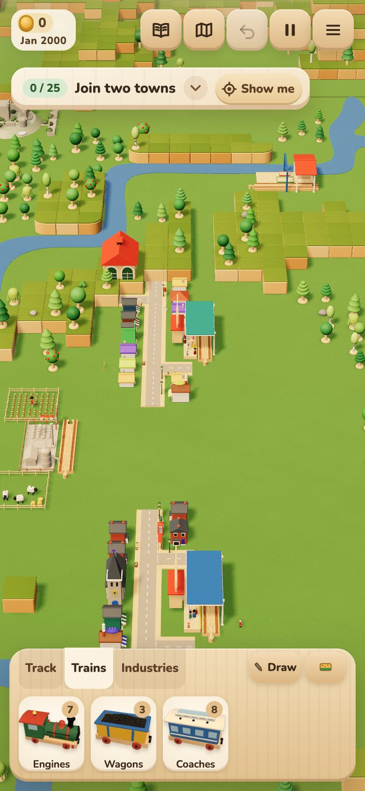
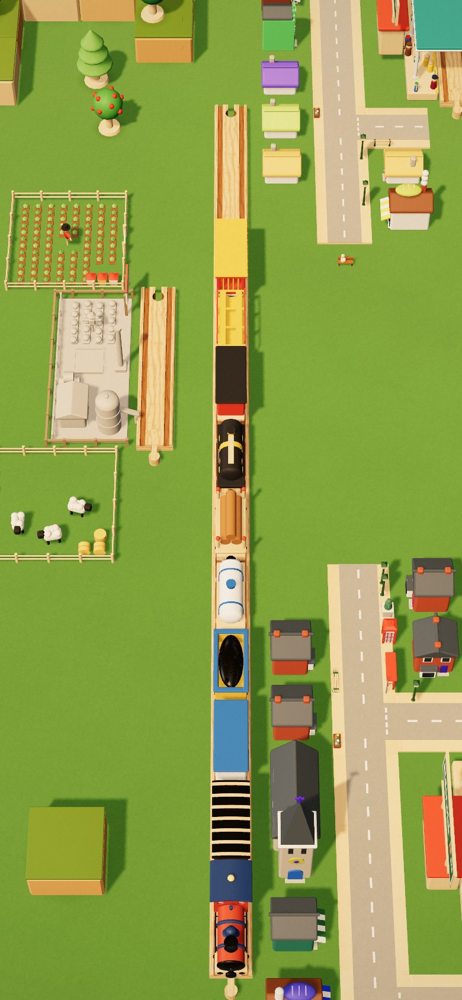
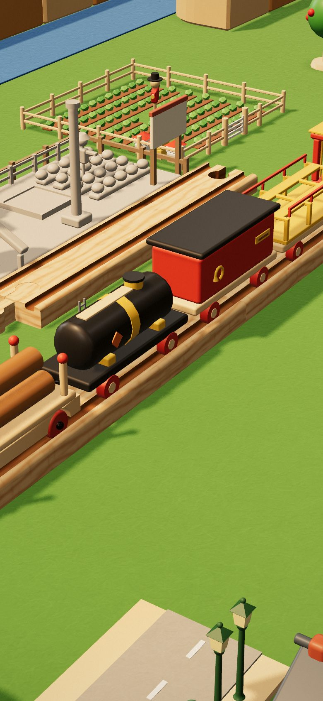
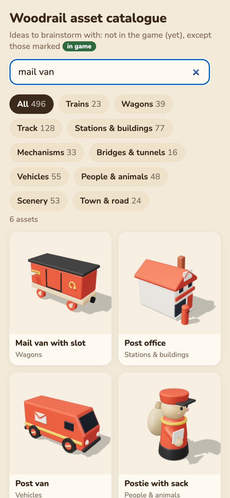
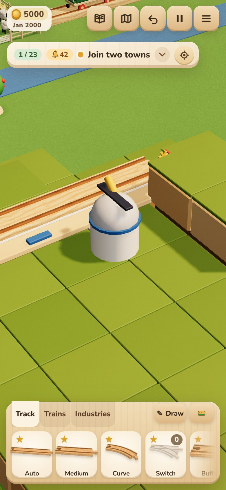

# Blender or Kit: where each belongs (2026-11-07)

A look-into report: nothing in the game is changed. The question was whether Woodrail should build more of its models
in Blender (`tools/blender/`, GLB sets in `public/models/`) or in the TypeScript Kit (`src/catalogue/kit.ts`).

**Short answer:** not more Blender across the board. Use it for a few big models seen close up. Before porting any of
them, try the cheaper fix of building those models at full Kit detail. The "duplicate trains" aren't a mismatch players
can see. The real loose end is the 11 newer wagon kinds that went back to the Kit after every car was moved to Blender:
each costs 3–9× the draw calls of a Blender car.

## How this was measured

- `node tools/perf/model-cost.mjs` (new): every catalogue asset built in a browser, at full Kit detail and at the props'
  in-game detail (0.5), and every model in the six GLB sets. For each it records triangles, meshes, materials, vertex
  bytes as loaded, whether it is a Blender model, and whether the game loads its file. Output: `e2e-out/model-cost.json`.
- `npm run perf:memory` after `npm run build` on today's main (6f8e1ab4): within budget. Mobile GPU geometry is
  **67.6 MB against a max of 68.2 MB**, so only 0.6 MB is left. It was 64.3 MB when the budget was set, so main has
  grown 3.3 MB since then.
- Pictures: `node tools/shots/blender-kit.mjs` (new) on a 390×844 phone @2x, plus the shots already in
  `docs/agents/shots/` from 2026-11-06, which show the current models.
- Blender itself isn't installed on this machine (no `bpy`, no `BLENDER_PYTHON`), so `npm run models` couldn't run.
  The Blender costs below are estimates. They use the measured ratios of the existing buildings set, which was ported
  from the Kit nearly line for line on 2026-10-14:
  - triangles are about 0.9× the full-detail Kit (404k against 453k);
  - vertex data is 26 B per triangle (the Kit's is 50–60 B per triangle: its primitives don't share vertices);
  - download is 1.45 B per triangle gzipped.

### The real split

The 496 catalogue assets include two files that the game never loads. `src/catalogue/registry.ts` has no `train` or
`track` entry. These files are brainstorm sketches, shown only in the dev catalogue viewer (`catalogue/index.html`, not
in the build): `trains.ts` (41 engines and wagons) and `track.ts` (128 track ideas). The game's own track comes from
`piece-carve`, not from the catalogue.

| | Blender | Kit |
|---|---|---|
| Catalogue assets the game loads | 103 | 207 |
| Viewer-only (`game-*` reference cars, `train-*`, `track-*` sketches) | 6 | 180 |

Outside the catalogue:

| GLB set | Models | Triangles | Download (gzipped) | Loaded |
|---|---|---|---|---|
| `trains.glb` | 16 | 126k | 212 KB | at boot |
| `dressing.glb` | 25 | 57k | 88 KB | at boot |
| `industry.glb` | 34 | 100k | 210 KB | Game mode |
| `buildings.glb` | 55 | 383k | 555 KB | when a building is first needed |
| `life.glb` | 48 | 386k | 612 KB | when a person or animal is first needed |
| `floors.glb` | 39 | 75k | 113 KB | when a town house grows a storey |

## 1. The duplicated trains: no visible mismatch

Everything a player sees of a train comes from one function, `buildCarModel` (`src/render/train-models.ts`):

- the track (`train-view.ts`);
- the tray's pictures (`thumbnails.ts`);
- the ferry (`ferries-view.ts`);
- the cards and the drag ghost (`interaction.ts`);
- the loading screen, which uses the same `trains.glb` through `shownModel`.

The tray and the track can't disagree.

The catalogue's `train-*` entries are the sketches from 2026-10-12 (`feat(catalogue): engines and wagons (41)`).
Players never see them.

The **real** duplication is inside `buildCarModel`. The 2026-10-14 work moved every car to Blender (spec
`2026-10-14-blender-models-design.md`). The car kinds added since went back to Kit builders:

- the milk tank wagon, the cold van and the tank wagon;
- the breakdown crane and the car carrier;
- the mail van and the sorting van;
- the circus cage and the observation car;
- the Royal Train (engine, saloon, observation car);
- the track cleaner.

At the phone's usual height the two kinds can't be told apart:

Close up, the difference shows. The Kit tank wagon (black) has a crisp box chassis next to the rounded Blender van
(red):

What it costs. Cars aren't batched: each running car draws its own meshes, and the shadow pass draws them again.

| Car | Built by | Meshes (draw calls) | Triangles (in game) |
|---|---|---|---|
| Engine, coaches, van, hopper, flatbed, cabooses | Blender | 7–10 | 5.6k–11.5k |
| Milk tank, mail van, tank wagon, cold van, crane, carrier, sorting van | Kit | 21–36 | 1.4k–3.2k |
| Circus cage | Kit | 70 | 3.6k |
| Royal engine, saloon, observation car | Kit | 54, 89, 79 | 4k–9k |
| Track cleaner | Kit | 32 | 6.9k |

These wagons also can't be painted at the paint shop: `WAGON_SLOTS` leaves them out.

**What depends on the catalogue sketches:** nothing outside the viewer. `trains.ts` is imported only by
`catalogue/assets/index.ts`, through `CATALOGUE`. The catalogue tests check ids and builds across `CATALOGUE`. 18 of the
41 sketches have since been built for real, so the viewer showed two of each (deleted since, with the user's OK):

- tank engine, mainline diesel, electric engine, rack engine;
- milk tanker, fuel tanker, car transporter;
- mail van, refrigerated van, crane wagon, log carrier;
- sleeper, dining car, observation car, double-decker;
- both cabooses, circus cage.

The viewer's "mail van" search below shows the sketch beside the game's own cars (`game-*`):

## 2. Ranked: move to Blender (or first, to full Kit detail)

The most visible flaw in the Kit props isn't the missing bevels. It is the **half detail**: props are built at
`PROP_DETAIL = 0.5` (`src/render/props/library.ts`), so a round dome becomes a few flat panels. The observatory shows it
plainly:

Each candidate below has two possible steps:

- **(a) Full detail:** build it with `new Kit(mats, 1)` instead of 0.5. This needs no pipeline.
- **(b) Blender:** port it to `kit.py`, which mirrors the Kit call for call, for rounded rims, recessed windows and
  smooth turned shapes.

"Kit now" is the in-game Kit model. Bytes are vertex data as loaded (floats). On the GPU both kinds are compacted by the
same ratio.

| Rank | Candidate | Models | Kit now: triangles / bytes | Blender estimate: triangles / bytes / download (gz) | What would visibly improve on a phone |
|---|---|---|---|---|---|
| 1 | **Grand projects, final stages** | 5 | 46.6k / 2.9 MB | ~137k / ~3.5 MB / ~194 KB | The trophy of each city, the thing players zoom in to look at. Rounded spires, recessed and arched windows (cathedral), a smooth ferris rim. One per city. |
| 2 | **Observatory** | 1 | 1.4k / 110 KB | ~4k / ~91 KB / ~5 KB | Its dome is the most faceted thing on the map (picture above). Step (a) alone fixes most of it. |
| 3 | **Secret sites, found** | 6 | 39k / 2.4 MB | ~86k / ~2.2 MB / ~122 KB | Castle towers and crenellations, the shipwreck's hull, the mine's timbers, seen close when found. They are on **every** Game map, so they weigh on the memory budget (see Cost). |
| 4 | **Boats** (tug, cargo ship, ferry) | 3 | 16.5k / 1.5 MB | ~36k / ~0.9 MB / ~51 KB | A rounded hull and bridge. The containers are boxes either way, so this gains less. |
| 5 | **Airship** | 1 | 1.4k / 104 KB | ~3k / ~86 KB / ~5 KB | A smooth envelope. It is built in `airship-view.ts` with its own Kit at 0.5. Step (a) is a one-line change. |

Pictures of each as it is now:

- [grand-cathedral-stage-4.jpg](shots/grand-cathedral-stage-4.jpg): the Kit cathedral beside Blender town houses, at
  the phone's usual zoom.
- [grand-exhibition-stage-4.jpg](shots/grand-exhibition-stage-4.jpg)
- [secret-castle-found.jpg](shots/secret-castle-found.jpg)
- [water-build-10-cargo-ship.jpg](shots/water-build-10-cargo-ship.jpg)
- [airship-2-airship-touring.jpg](shots/airship-2-airship-touring.jpg)

At the usual zoom, the town's Blender houses and the Kit cathedral already read as one style. The gain is close up, as
with the wagons.

Not worth porting: the earlier grand-project stages (0–2 are fences and scaffolding, seen for a short time), and the big
top and the lift bridge. The lift bridge is a mechanism (see section 3).

## 3. Ranked: keep in the Kit

1. **Track.** Joins, pegs and grooves come from `piece-carve` and the piece definitions, sized to the millimetre. A
   modelled piece would have to match them exactly. That gains nothing, and a carving change would mean rebuilding
   models.
2. **Mechanisms sized or moved by game logic:**
   - the lift bridge, the train lift and the turntable;
   - depot tracks and the gantry over 2 or 3 tracks;
   - Grand Central's real track;
   - the crane's pose (`poseCrane`);
   - the generated station and town walls, sized to their squares.

   Blender can carry named pivots, but not sizes chosen at run time.
3. **Many-instance scenery** (64 `scene-*` assets: trees, rocks, fences). Blender's fixed full detail costs more
   triangles than the Kit at half detail. For the cars that was about 2–3× more triangles, and the shadow pass draws
   them twice.
4. **The rest of the cheap, distant props** (vehicles, most mechanisms): they're too small on screen to show rounded
   edges.

**Colour variants and hue shifts are not a reason to keep anything in the Kit.** `catalogueModel` passes a Blender
model's lacquer through `k.paint`, so `shiftHue` variants already work on Blender buildings and people. Painting works
on Blender cars through recolour maps.

**`floors.glb`: worth it, keep it.** It is what lets town houses grow storeys (issue #17, `props/storeys.ts`). It costs
113 KB gzipped, fetched only when a house first grows, and about 360 lines (`floors.py`, `bldg_floors.py`,
`storeys.ts`). The alternatives are worse:

- one model per house and storey count would be about 35 more models, several times the download;
- Kit-built stacks wouldn't match the Blender houses they sit on.

**One to look at the other way:** the people and animals in `life.glb` are heavy for their size. They average 8k
triangles. `life-seagulls` is 19k and `life-family` is 18.6k. They appear in numbers, so it may pay to lower their
segment counts in `life_parts.py`. They should stay in Blender, at lower detail. This report doesn't measure how many
appear on a late map.

## 4. Ranked: retire the duplicate

1. **The 11 Kit-built wagon kinds and the Royal Train**, in `buildCarModel`. There are two ways to fix them, and the
   first doesn't need Blender:
   - **Merge each Kit car's static meshes by material** when it is built: the wheels and brushes stay apart, everything
     else is merged (the Blender bake does the same). This cuts 21–89 draw calls a car to about 6–11, and the triangles
     stay the same. It is a code-only change in `codeCarModel` and `cleanerModel`. It needs care with names the game
     reads: `poseCrane` and the cargo layout.
   - **Port them to `trains.py`.** This gives the rounded look and makes them paintable through `WAGON_SLOTS`. Cost:
     about +50–70k triangles and +80–120 KB gzipped on `trains.glb`. That file loads **at boot**, so these models would
     belong in a set of their own, loaded when first needed. It also needs Blender installed.
2. **The catalogue's `train-*` sketches** (`src/catalogue/assets/trains.ts`, 1,477 lines). The small fix is to delete
   the 18 sketches the game has built for real and keep the 23 unbuilt ideas, such as the snowplough, the tram, the
   fire engine and the cement mixer. Nothing that ships changes: no bundle, memory or download cost, because the viewer
   isn't in the build. The viewer then stops showing two mail vans, two cabooses and so on. Deleting the whole file
   would also work, if the viewer is no longer used for brainstorming. **Done, with the user's OK:** the 18 are gone,
   with the four helpers only they used (`coach`, `van`, `toyCar`, `setPanto`).
3. (Not asked, same pattern) `track.ts`'s 128 track sketches are also viewer-only. Some, like the bridges and the
   tunnel, now exist in the game in other forms. Pruning them could wait for a pass over the viewer.

## Cost, in one place

- **Memory.** Mobile GPU geometry has 0.6 MB of headroom. The secret sites are on every Game map, the `features` perf
  map too (its budgets note them). Its list of features (`perf.md`) has no grand project, so:
  - porting the secrets (rank 3) changes `mobile.gpu.geometryMB` and needs a budget update with numbers;
  - step (a) on the secrets roughly doubles their triangles, and could add about 2 MB of floats before compaction;
  - grand projects and the observatory aren't on the perf map today. Add them there before porting, or the budgets
    won't see the change.
- **Triangles, not bytes, are the real cost of Blender.** Per triangle, Blender's vertex data is half the size of the
  Kit's. So a Blender port is about the same in memory but 2–3× in triangles (the shadow pass doubles that).
- **Download.** Every candidate above together is about 380 KB gzipped, against 23–30 KB for the Kit code it replaces.
  Put each group in a lazily loaded set of its own (grand, secrets, water), never in a boot set.
- **Authoring.** Each port goes into `kit.py` nearly line for line. It needs `BLENDER_PYTHON`
  (`pip install bpy==5.2.2`, Python 3.13), which isn't on this machine. gltfpack is (via npx).

## Recommendation, in order

1. Merge the Kit-built cars' meshes by material. This is cheap, code-only, and cuts draw calls while trains run.
2. Build the few close-up Kit props at full detail (step a): the observatory, the airship, the grand projects' final
   stages, the boats. Check the secrets against the memory budget first. Look again at the zoom players use.
3. Only then, if close-up quality still matters, port the grand projects' final stages to Blender as a lazily loaded
   set of their own.
4. Delete the 18 built-for-real `train-*` sketches from the viewer (done).
