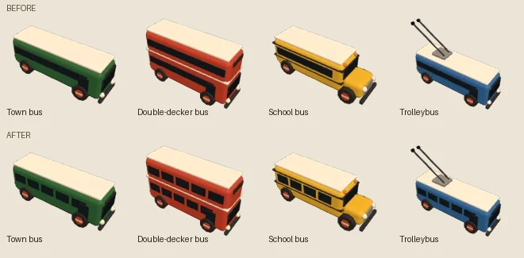

# Woodrail visual asset audit · 21 November 2026

[Browse the illustrated asset index](asset-audit-index.html). Choose a collection and search by name or model ID. The model, track and picture collections overlap. A cathedral in the catalogue, its source mesh and its construction stages each answer a different question.

## Comparing the latest models

Select a card to inspect its current artwork. Individually revised models have paired before-and-after portraits and appear under **Changed only**. Shared finish updates and regenerated thumbnails have a single current portrait. The catalogue baseline is the saved inventory before the bus pass. The eleven concept engines and twelve concept wagons have larger matched portraits. These models are catalogue concepts. The live railway engines appear under their own game and GLB entries.

The broader finish pass maps bare beech and routed wood on Kit parts in millimetres along the longest dimension of each part. This carries through to wagon decks, posts, axles and timber structures. The stone barge now carries staggered quarry blocks. Its ore counterpart keeps its rounded russet rocks. Source models and registry entries can represent the same artwork, so a changed-image count across collections includes duplicates.

## Full model pass

All 479 catalogue models and the 221 models in the seven source libraries were rebuilt in the renderer. Painted parts use the same satin finish on individual models and in the batches used on the board. Substantial wooden cylinders have eased rims. Registered track connector portraits and all 65 published game pictures were refreshed as well.

The catalogue's **Changed only** filter now contains 222 entries with specific shape or construction revisions. This includes the eleven remaining concept wagons, concept track boards, station slabs and mechanism decks with recessed running channels, shoulder-profile road tyres, turned scenery stands, building windows and doors, and the people and animals that use the revised collar or hoof profiles. Source-library and registered-kit entries can refer to the same models. Entries with a shared finish update alone keep a single Current portrait.

The dairy, bakery and juicer also have new yard equipment. Select their entries under **Published pictures** to compare the actual yard views. The standalone catalogue buildings and their full industry yards are separate subjects.

The production build and typecheck passed. The full unit run passed 7,185 tests with 92 skipped. All 64 road checks and 38 kit checks passed. Browser checks verified the catalogue navigation and the comparison states across all five collections. Seven measurements exceeded the memory budgets, including geometry at 78.5 MB on mobile (68.2 MB budget) and 86 MB on desktop (72.4 MB budget).

## Freight buildings and watermill

The tall catalogue warehouse has a projecting hoist loft and a dock directly beneath its lifting sack. The playable warehouse is a separate freight shed. It now has a glazed roof lantern, two bays of road-facing windows and a canopy above the loading door. The goods shed shares the lantern profile. The watermill has a timber millrace feeding a broad-rimmed paddle wheel. Their close-up comparisons use the immediately preceding models as the baseline. The full warehouse yard is also visible in the Published pictures collection.

## Initial priorities from the audit

1. **Give three small industries a recognizable object above the loading pad.** The bakery, dairy and juicer are easy to confuse in the published pictures. All three have a low rectangular building alongside the same prominent strip of track. Try a squat oven chimney for the bakery, two turned milk churns for the dairy, and a wooden screw press for the juicer. Keep the loading side open. Compare the three together on a phone and in the tray, with labels covered. [Published industry pictures](../../src/wiki/pictures/) · [Yard dressing](../../src/render/industry-dressing.ts)
2. **Make bulk goods recognizable by shape when loaded.** The stone and ore barges use the same nine rounded rocks in the same positions. Coal and grain share a smooth heap. Try chunky grey quarry offcuts for stone and keep the rounded rust-coloured rocks for ore. A few large dark facets along the top of the coal load would distinguish it from smooth grain. Check an empty, half-full and full hopper beside the corresponding barge. A load should stay inside both rims. [Barge models](../../src/catalogue/assets/water.ts) · [Cargo layout](../../src/render/cargo-layout.ts)
3. **Give workshops and town buildings deliberate roof silhouettes.** At the board camera angle, players see a lot of roof. The bakery’s street awning and the shopfronts do good work at eye level, but a plain roof can hide almost all of that identity. Start with one roof vent or chimney on the low industrial buildings. Keep the simple roofs on ordinary homes so the works and civic buildings stand out. Frame the street from both directions before propagating a detail to the modular upper floors. [Buildings and floor generators](../../tools/blender/)

## First change made

All four buses had an uninterrupted glass band running almost the length of the body. A row of separate dark panes lets the body paint form broad pillars. The panel spacing reads on the green town bus, both decks of the red bus, the shorter yellow school bus and the trolleybus. The school bus keeps its bonnet and the trolleybus its overhead poles.

| Model at prop detail | Before | After |
| --- | ---: | ---: |
| Town bus | 1,268 | 1,220 |
| Double-decker | 1,484 | 1,388 |
| School bus | 1,688 | 1,628 |
| Trolleybus | 1,472 | 1,424 |

Triangle counts include the entire model. The new flat panels reuse the existing glass material. The town bus is the variant used by live road traffic. [Vehicle builders](../../src/catalogue/assets/vehicles.ts) · [Road vehicle selection](../../src/render/road-vehicles-view.ts)

## Findings across the set

| Family | Finding and suggested treatment |
| --- | --- |
| Engines and passenger stock | The classic steam, diesel and electric silhouettes separate cleanly. Sleeper, diner and first-class coaches share a convincing wooden body. The metro and royal train pictures spend much of their width on the length of the consist. Try tighter lead-car crops for small picker tiles and keep the entire consist on its detail page. |
| Wagons and loads | The tanker’s straps, the flatbed’s stakes and the crane’s boom read even with the vehicle empty. The mail and sorting vans have very similar dark roofs and red sides. Try one broad cream mail panel on the sorting van, then check both under custom paint. |
| Track, joins and adapters | The male tongue, routed female socket and paired grooves carry the wooden-toy impression. Keep a connected pair as the reference for all connector work. For future changes compare a short adapter, an S-curve, a mirrored switch and a curved ramp under the same grazing light. The tongue should read as one continuous piece of wood from that angle. |
| Ramps, bridges, tunnels and mechanisms | The red arch immediately identifies an elevated piece. The stone viaduct and the timber trestle already have their own outlines. The lift bridge, train lift and gantry crane all feature a tall rectangular frame. Prototype one large painted counterweight at the lift bridge pivot and judge it in both deck positions, with a train below. |
| Stations and lineside furniture | The station clock and water tower work through outline alone. The furnished platform has 20,612 triangles before batching. When optimizing it, simplify repeated fittings first and preserve the canopy edge, clock face and space for peg passengers. |
| Industries, yards and infrastructure | The saw blade, winding wheel and windmill sails give the older industries a clear working identity. Carry that idea into the small food-chain yards above. For the airport and airship mast, judge the building with the aircraft both present and away. A portrait of bare depot track omits the yard. |
| Houses, shops and civic buildings | The stepped gables, varied roof colours, shop awnings and school bell make good landmarks in a street. A single strong roof feature will travel farther than small window trim. Check stacked floors for aligned doors, porches and roof overhangs before revising a whole house family. |
| Grand projects and secrets | The cathedral spires, exhibition ribs and castle towers already reward close inspection. Spend the next pass on the middle construction stages. Show the cathedral’s first arch or a short roof rib while it is still a timber worksite. The hidden and restored secret sites should stay distinguishable even with the mist switched off. |
| Road and farm vehicles | The bus windows were the clearest shared fix. The family car, taxi and police car share a useful saloon silhouette. Retain the taxi sign and beacon. For the delivery and post vans, compare a larger side parcel or envelope print before adding handles or wheel detail. |
| Boats, barges and aircraft | The tug’s wheelhouse, ferry’s open track and seaplane’s floats tell players what each vehicle does. The cargo ship is already 24,196 triangles. Spend the next increment on its load silhouettes. Compare with the vessel at its waterline, since the blue display bases appear only in the catalogue for many boats. |
| People and wildlife | Hats, overall colours and tools already distinguish the station staff. Tiny figures with props can be expensive in groups. The seagulls model has 19,424 triangles and the family has 18,604. Count visible instances before simplifying. Keep bird bills, hats and the gaps between figures in any distant model. |
| Trees, hills, rock and water | Conifers, rounded broadleaf crowns and fruit trees make a good family of distinct wooden forms. Repeated lollipop trees can line up as identical circles. If repetition shows on a dense map, try two crown proportions distributed by the existing stable placement seed. Inspect a hill cut, tunnel portal and ramp together before changing the block edge. |
| Town props, signs and signals | The red post box, phone box, clock and lamp have strong board-scale outlines. At small sizes a semaphore arm or lit signal face matters more than a detailed base. Check both directions of a pair against trees, roofs and bridge paint before revising signal colours. |
| HUD artwork, wiki and materials | The icon set reads as printed toy-box artwork. Test small paired symbols together, especially van/bus and ore/coal/stone. Keep the common wood palette across trays and board. For the industry thumbnails, compare a tighter yard crop with the existing full footprint after the yard silhouette work. |

## Coverage and limits

The index contains **479 catalogue portraits**, **221 source models** in seven GLB sets, **237 registered track types** (86 ordinary pieces, 51 kits and 100 generated connector entries), **65 published wiki pictures** and **114 SVG icons**. GLB source portraits include individual floors, cargo and moving parts. Those portray geometry in isolation and can differ in paint or assembly from their appearance on the railway. The 51 kit entries point to the corresponding catalogue model. The track-only depot portraits represent the bed, while the published industry pictures include the yard.

The visual review used one consistent three-quarter view for the model inventory, the published wiki art and selected board views of industry, towns, transport, signals, hills and joints. Earlier gameplay captures provide context and can predate the current materials. Model counts in the index describe authored geometry at the captured detail. Runtime batching, culling, shadows, repeated instances and far meshes determine the actual frame cost.

The audit concerns visual assets. Procedural variations such as player liveries, continuously fitted track, arbitrary town layouts, cargo fill levels, every camera angle and every animation frame have more combinations than the inventory can show. Recommendations involving those states have a proposed in-game comparison before an art change.

## Initial audit checks

The production build and typecheck passed. The unit suite reported 7,183 passes and 92 skips. The road suite ran all 64 checks, including the bus-stop interactions. The index opened locally in Chrome, all five collection totals matched the inventory, and a curved-ramp search worked at a 390 px viewport width.

The full performance gate remains open. Its frame sampler reads Linux `/proc` and failed on macOS. Under Chrome Metal, the features board measured the same GPU memory with the original and revised bus windows (202.2 MB mobile, 300.9 MB desktop). Six memory budget overruns also occurred with the original windows. The revised build additionally measured 43.2 MB for desktop JavaScript heap against a 43 MB budget, versus 42.7 MB in the baseline run. Those are single-run measurements.
