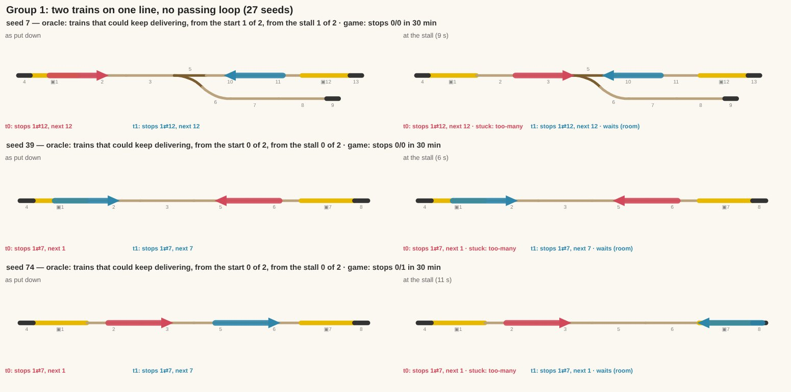
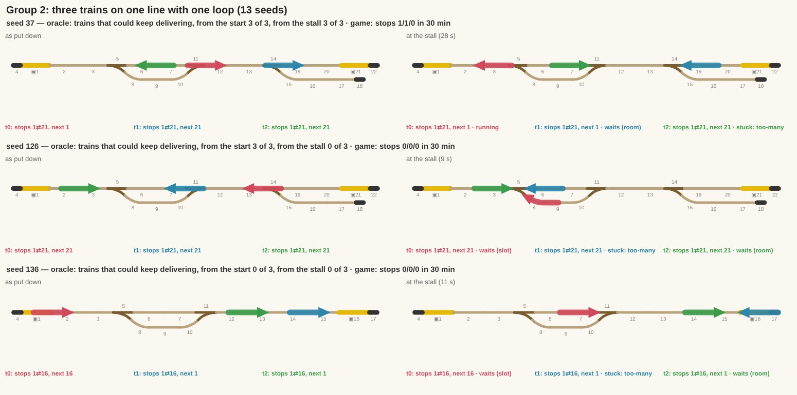
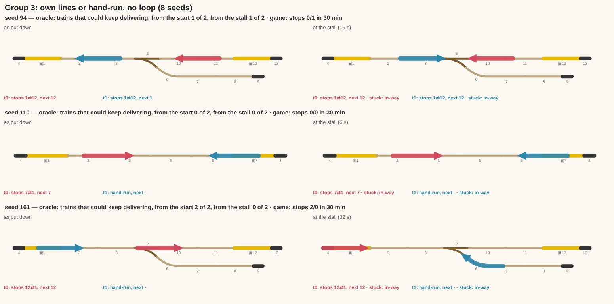
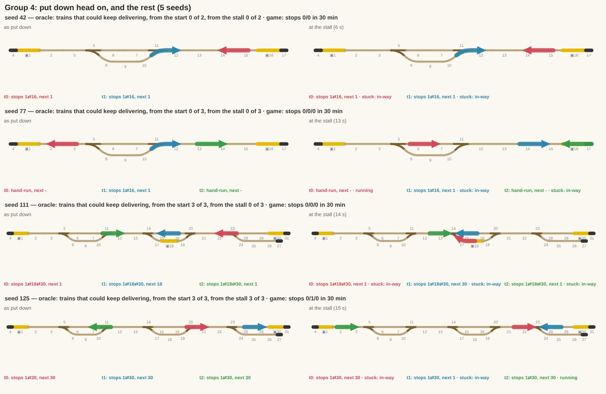
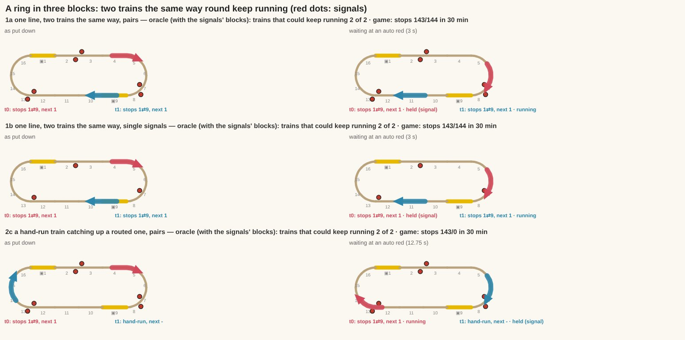
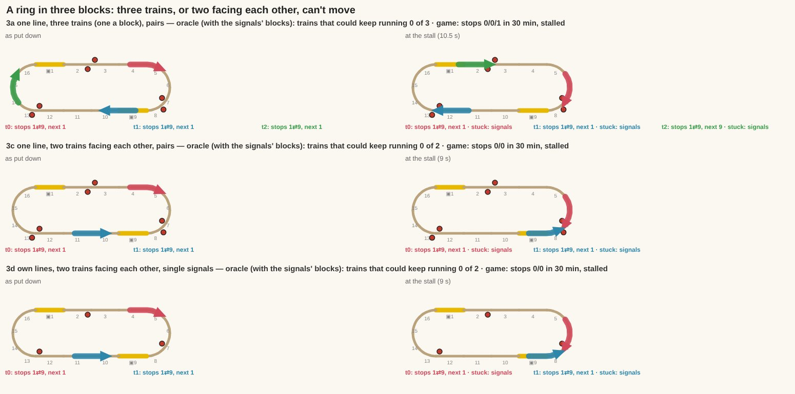

# The long fuzz's stalls: are they really deadlocks? (2026-11-10)

An independent check of the earlier classing of `npm run fuzz:long`'s stalled seeds as "deadlocks the player made". The
user's doubt: "Are they really deadlocks though??" Nothing in the game changes on this branch; the fixes below are
proposed only, as patches beside this report.

## Short answer

**Mostly yes, but not all, and the biggest wrong group is the one with a loop.** On today's main (f10b8ee) the plain
long fuzz (200 seeds × 30 game minutes) stalls on **53** seeds (one more than the 52 the earlier analysis had). An
exhaustive search of every move a perfect dispatcher could make under the user's rules says:

- **39 are true deadlocks.** From the moment the trains were put down, no sequence of moves gets every train delivering
  again, whatever the game does.
- **10 are deadlocks of today's waiting rules.** Every train could still deliver *at the moment of the stall*. Nine of them
  the room rule holds; a one-line change to it runs all three trains (44–51 stops each in 30 minutes, against 0–1).
- **4 the game walked into.** They started solvable, and the game's own moves made them true deadlocks within 30 s
  (111, 126, 165: a loop filled with two trains going the same way; 161: a hand-run train held on points).

| Earlier group | Seeds | Verdict | Tested fix |
|---|---|---|---|
| Two trains on one line, no passing loop | 27 | **True deadlock, all 27.** In 12 (those with a siding) one train could keep working if the other stood in the siding; today both stand (0–1 stops each). | none can make both run; siding parking is untested |
| Three trains on one line with one loop | 13 | **Avoidable: 11 of 13.** 9 held by the room rule (2 trains for 1 loop), 2 the game filled the loop one way. 2 true (136, 149). | exp1 fixes 9, exp2 the other 2 |
| Own lines or hand-run trains, no loop | 8 | **True deadlock, 7 of 8.** 161 is avoidable: the game held a hand-run train on points. | exp3 runs 161 for 25 min (81 stops, was 2), then it stalls another way |
| Put down facing each other (and the rest) | 5 | 42, 190, 77 **true**. 111 avoidable (exp2). 125 avoidable only by a train hiding in a siding. | exp2 fixes 111 |

All told, **exp1 + exp2 take the plain fuzz from 53 stalled seeds to 41, with no new stall.** On the plain fuzz there's no new
invariant break. With signals they add three (`greenHeld` on 165, `heldFree` on 126 and 136), while taking ten seeds
off those lists. So they're proposals that work, not patches ready to land.

## How this was checked

1. **The stall list.** `ROUTING_FUZZ=50 … -t "routing fuzz: "` in 4 shards: the plain fuzz only, the one the stall
   lines come from. 53 seeds; in every one the trains deliver next to nothing all run (0–2 stops in 30 minutes), the
   trains not called stuck included.
2. **A dump of each seed** (`src/routing/stalls-verify.test.ts`, skipped unless `STALLS_VERIFY=<seeds>`): the track, and
   each train as put down, at its first stall and at the end. Where it stands (front first), which way it drives, its
   route and next stop, and who it waits on (sections' wait, the router's, the sim's hold, the room rule, the stall kind).
   `STALLS_TRACE=<s>` prints that every second.
3. **A dispatcher oracle** (`src/routing/stalls-oracle.ts`). From a set of train positions it searches every sequence
   of moves allowed by the user's rules, then asks how many trains can keep delivering for ever: a strongly connected set
   of reachable states in which a routed train comes to every one of its stops, and a hand-run train keeps moving. The
   rules, built in:
   - trains turn round only at the end of the track. "any" means any end, a siding's too; "own" means a routed train only
     at an end that is one of its stops;
   - a train never comes to rest with a car on points. A move runs on through points to the first place clear of them;
   - every lever may be set either way, move by move, as a player or a perfect signalman could.

   It is generous to the trains: a train fills 2 whole pieces (268 mm on 216 mm pieces, the least it can stand on), and
   it may wait anywhere on plain track. So when it says "impossible", it is.
   **Validated on all 200 seeds:** on every one of the 147 the game runs without a stall, the oracle agrees that every
   train can deliver. It never calls a working layout impossible.
4. **Sketches** (`tools/shots/stalls-sketch.mjs`, from the dumps): each seed as put down and at its stall. The trains
   are bars with an arrow on the end they drive to, and ▣ marks a stop. Pictures:
   `docs/agents/shots/stalls-g1-two-no-loop.jpg`, `stalls-g2-three-one-loop.jpg`, `stalls-g3-own-lines.jpg`,
   `stalls-g4-other.jpg`.
5. **Each fix claimed was run** on a scratch copy: the 53 seeds dumped again, then the plain fuzz on all 200 seeds, then
   the full `npm run fuzz:long` (plain, with signals, a route never makes it worse). The patches are in
   `docs/agents/stalls-verify/`.

The fuzz's lines all have the same spine: a buffer, stop A, two straights, 0–2 passing loops (main road 2 straights,
side road curve–straight-or-stop–curve), maybe a siding (points facing a train going from A towards B), two straights,
stop B, a buffer. 1–3 trains are put down at random places, facing at random.

## Group 1: two trains on one line, no passing loop (27 seeds): true deadlocks

**What they do.** 11 are put down head on, 13 facing the same way (a convoy), and 2 facing apart (they run to opposite
ends, turn, and meet head on). The room rule gives the line room for one train and holds the other *where it stands*. In
every one of the 27 the held train stands between the admitted train and a stop it needs, so the admitted train waits
too, at the points or the stop.

- **Seed 7** (top). t0 (red) is at stop A heading for B. t1 (blue) is near B facing west, so it must reach A to turn.
  The siding's points face t0. t1 is held for room on 10–11. t0 comes up to the points and waits short of them, for t1.
  Stall at 9 s, 0 stops each in 30 minutes.
- **Seed 39.** No siding, the two put down nose to nose. Nothing can move: 3 reachable states.
- **Seed 74.** No siding, both facing east. The front one reaches B and turns, and then they face each other. The game
  holds the back one from the start: 0 and 1 stops.

**True deadlock?** Yes, for all 27. With no passing place, two trains on one line keep their order, so the west one can
never reach B and the east one never reach A. The oracle finds 0 of 27 where both can deliver, from the start or from the
stall.

**But one could keep working in 12 of them.** These are the ones with a siding: 7, 52, 93, 100, 105, 146, 151, 158, 159,
169, 192, 197. The siding's points face trains going east. So if the east-going train runs into the siding and stays
there, the other runs A ⇄ B for ever. That holds even with "own" ends (the hidden train just stands, it doesn't need to
turn). Today neither moves. In the other 15 (no siding, or one that faces the wrong way for the train in the way),
nothing can deliver at all.

**Could the player avoid it? Is it said in time?** Yes, and yes. The player avoids it by not putting a second train on a
loopless line, or by laying a loop between the two. The game says so at once:
- the toast when the line first has a train with no room: "This line has room for 1 train. Lay a passing loop, or take one
  off the track.";
- the held train's card: "Waiting: lay 1 more passing loop for 2 trains, or remove a train";
- 5 s later the other's card: "Stuck: this line has a train too many. Add a passing loop, or remove a train".

The stall is said 6–17 s in.

**Could the game prevent it?** Refusing the train isn't the answer under "placement is forgiving", and a train held
anywhere on single track blocks it whatever the game does. What would help:
- the warning *before* the second train joins the line (on the route sheet's "+ train", or the drop), naming the fix;
- parking the held train in a siding where there is one, so the other keeps working. Untested; the oracle says it would
  keep 12 of the 27 half running.

## Group 2: three trains on one line with one loop (13 seeds): mostly not deadlocks

**What they do.** The room rule gives a line `loops + 1` trains: 2 here. So one of the three is held where it stands,
usually at a line end or on the single track, and the other two wait for it.

- **Seed 37** (top). t1 (blue) is held for room on 19–20, the B end. t2 waits in the loop for the slot. t0 runs to A,
  then has nowhere to go: 1/1/0 stops in 30 minutes.
- **Seed 126.** All three head for B. t0 (red) and t1 (blue) face west, so they must turn at A first. t2 (green) is at A
  facing east. The game at once sends t0 into the loop's free road. That puts two west-going trains in both roads, with
  t2 coming east on the single track beyond. From there nothing can move.
- **Seed 136** (bottom). t1 and t2 are put down one behind the other in the B-end stretch, both facing B. t1 turns at B
  and meets t2 head on. True.

**True deadlock?** **No, for 11 of 13.** Three trains *can* all work one line with one passing loop. The two line ends
are places to wait too, so there are 4 places for 3 trains, and the free one moves round like the gap in a sliding
puzzle. The oracle finds every train delivering in 11 of the 13, and in 9 of them still at the moment of the stall
(34, 37, 91, 112, 132, 134, 145, 186, 188). The same shape on *own* lines (no room rule there) runs in 5 of its 6 seeds.
Only 136 and 149 are true: two trains put down nose to tail heading into the same line end.

**Tested: exp1, the room rule counts the line's ends** (`room = loops + 2` once there is a loop, `loops + 1` with none;
one line in `Sections`):
- 9 seeds fixed: 34, 37, 91, 112, 132, 134, 145, 186, 188, each train 44–51 stops in 30 minutes;
- 0 new stalls on the 200 seeds, and no new invariant break;
- 8 seeds come off `heldFree`'s known list.

**Tested: exp2, a loop's last free road is kept for a train coming the other way.** When a train would take the last free
road of a loop, every other road holds a train going the same way, and another of the line's trains is coming at the loop
from the far side, it waits where it is.
- On top of exp1, it fixes 126 and 165 (44–46 stops each) and group 4's 111 (66–67 each);
- 0 new stalls.

The waiting train stands on plain track, clear of points.

**Could the player avoid it? Is it said in time?** The player is told the wrong thing: "This line has room for 2 trains.
Lay another passing loop, or take one off the track." A third train fits. The second loop isn't needed.

## Group 3: own lines or hand-run trains, no loop (8 seeds): true, but one

**What they do.** Two trains on separate lines, or one on a line and one hand-run, share track with no passing loop. No
room rule applies, as they're not one line. They meet head on and the stall is said: "Stuck: the … train is in the way.
Add a passing loop here".

- **Seed 94** (top). Two lines, both A ⇄ B, both facing west. t1 reaches A, turns, and meets t0. True deadlock; one of
  them could have kept working using the siding (oracle 1 of 2).
- **Seed 110.** One routed train and one hand-run, put down nose to nose with no siding. True.
- **Seed 161** (bottom). One routed train (t0, B ⇄ A) and one hand-run (t1).
  - The start is solvable: the oracle has both delivering.
  - t1 runs into the siding, turns at its buffer and comes back out. Inside the siding it isn't on the line's track, so
    sections leave it alone.
  - Its front reaches the siding's points and it becomes the line's. It is held there, *on the points*: the routed train's
    only way east.
  - Stall at 32 s: 2 and 0 stops.

**True deadlock?** 7 of 8: 60, 66, 94, 96, 110, 157, 189. Of those, 66, 94, 96 and 189 could keep one train working in
the siding. **161 is the game's**, breaking the user's rule "points are never a place to wait".

**Tested: exp3, a hand-run train works the line from before the points it comes onto.** It counts as one of the line's
trains once the track 3 pieces ahead of it enters the line's track, so it asks for the way while still clear of the points.
- 161: t1 now waits in the siding, clear of the points, and t0 makes 81 stops (was 2).
- At 24.7 minutes t1 meets t0 head on again: it comes back out and runs the way the points lie, onto them, into t0.
  That one is held by the sim's nose-to-nose rule, not sections, so the fix is partial.
- On all 200 seeds: see "Regression runs".

**Could the player avoid it?** In the 7 true ones, by laying a loop, which the card says only after the stall. The game
could warn when a train is routed over track another line, or a hand-run train, uses with no passing loop on it. In 161
the player did nothing wrong.

## Group 4: put down head on, and the rest (5 seeds)

- **42, 190: true.** Two trains of one line put down head on between the loop and B, with nothing between them. 3
  reachable states.
- **77: true.**
  - What it is: one routed train (t1) and two hand-run, t2 ahead of t1, both facing B. t2 turns at B and meets t1 head
    on. t0 (hand-run) runs into the loop and stands behind them.
  - The oracle: 0 of 3 from the start, so nothing could have helped.
  - Not counting hand-run trains in the line's room: no change, since there's no room rule in play (they're not one
    line). `KNOWN_WORSE` already calls it "a true deadlock, nothing turns".
- **111: the game's** (two loops, a siding, three trains). It starts solvable (3 of 3), and the game fills the second
  loop's roads with two west-going trains while the third comes east. exp2 fixes it (66–67 stops each).
- **125: placement, and avoidable only by a siding.**
  - What it is: t0 is put down on the single track past the second loop, facing B. t1 is at the B end facing B, so it
    turns and comes back into t0. Between them are the siding's points, facing t0.
  - With a siding turn ("any" end) all three can still deliver at the stall. With "own" ends, two can, and t0 stands in
    the siding.
  - Untested. The game has no rule that sends a routed train into a siding that isn't on its route.

## Ranked fixes (proposed, not on this branch)

On the 53 seeds of today's main, plain fuzz, 30 game minutes:

1. **The room rule counts line ends that fit a train** (exp1, `docs/agents/stalls-verify/exp1-room-counts-ends.patch`).
   - **Seeds:** 53 → 44 stalled; 9 come off, every train delivering. Tested.
   - **Why:** the biggest single cause, and the one telling players to lay a loop they don't need. One line as tried.
   - **Built properly:** count the line's end slots that fit its longest train, not a flat +1. A line whose end is
     mid-track, or too short for a train, has no such end, and a ring has none.
   - **Also update:** the toast and the "lay N more passing loops" card text, and `heldFree`'s known list.
2. **Keep a loop's last road for the other way** (exp2, `exp2-last-road.patch`, on top of 1).
   - **Seeds:** 44 → 41; 111, 126, 165 come off. Tested.
   - **Cost:** with signals, 1 + 2 bring three new invariant breaks (see "Regression runs"), so they need work before
     landing.
   - **Why:** a wait short of a loop, on plain track. It is the "train waiting short of the section rather than in it"
     idea, and in the redesign it belongs to booking: a booking into a loop road shouldn't take the last road one way
     while a train is booked or standing to come the other way.
3. **Hand-run trains ask before points onto the line** (exp3, `exp3-hand-run-before-points.patch`).
   - **Seeds:** 161 delivers for 25 minutes instead of 30 s, then stalls a second way. Tested (161, and on all 200 seeds:
     see below).
   - **Why:** the user's "points are never a place to wait", for trains off the line's track. The second stall needs a
     hand-run train to stand short of facing points it would run onto against a train coming. That's the redesign's
     §3.10, hand-run trains reserving as points lie.
4. **Park a held train in a siding, where there is one.**
   - **Seeds:** untested, by the oracle only. None of the 53 would deliver with every train, but one train of two keeps
     working in 16 of them (12 of group 1 and 66, 94, 96, 189 of group 3), and 125 runs.
   - **Why:** the "holding a train in a depot siding" idea. Worth it only if a half-working line is better for a player
     than a clear stop with a clear card; I'd ask the user.
5. **Warn before, not after, for the 39 true deadlocks.**
   - **Seeds:** none come off, they're true. They're said 6–30 s in today, with the right fix on the card.
   - **What:** prevention would be a warning when the train is added. "+ train" on a line at room, or a route over track
     another line uses with no loop on it: "These trains can't pass each other here: lay a passing loop first". Not a
     refusal (placement is forgiving).

Ideas tried or weighed that don't help these seeds:
- **One train at a time on single track:** that's what sections already do.
- **Hand-run trains counted in a line's room (77):** the oracle has 77 a true deadlock from the start.
- **Holding at the station before the single track:** that's exp2's case. Elsewhere the trains already wait at a slot or
  short of points.

## Regression runs

- **Plain fuzz, 200 seeds × 1800 s, exp1 alone:**
  - 44 stalled (base 53), none new, no new invariant break;
  - `heldFree` breaks on 10 seeds (base 18; 37, 91, 112, 132, 134, 145, 186, 188 come off);
  - the only failing check is the known list's "take them off" guard.
- **Plain fuzz, exp1 + exp2:** 41 stalled, none new. The same 10 `heldFree` seeds, nothing else.
- **Full `npm run fuzz:long`, exp1 + exp2** (3 shards, 39 min):
  - Plain: 41 stalled, as above.
  - "A route never makes it worse": passes.
  - **With signals: three new breaks.**
    - `greenHeld` on seed 165 (a train held 5 s at a signal showing clear, at 30.7 s); 37 comes off that list.
    - `heldFree` on 126 and 136; 37, 91, 112, 132, 134, 145, 165, 186, 188 come off it.
    - Both are known classes, due to go with redesign steps 4–5 (signals show the table, sections grant by booking).
      Still, exp1 + exp2 can't land as they are without those three looked at and the known lists updated.
- **Plain fuzz, exp3 alone:**
  - all 15 checks pass; 52 stalled (base 53); 161 off the fuzz's stall lines, none new;
  - `heldFree`'s 18 seeds the same as main's.
  - The dump test (run in 1 s steps) still sees 161's second head-on at 1482 s. So "off the list" means it ran nearly
    the whole half hour, not that it's fixed for good.

## What I'd tell the user

They're mostly real: 39 of 53 can't work under your rules from the moment the trains are put down, whatever the game
does. The earlier class "three trains on a line with one loop" is the exception. Those aren't deadlocks: three trains fit
one loop, because the line's two ends hold a train each. The game's room rule (one more train than loops) is too strict,
holds the third, and tells the player to lay a loop they don't need. Four more the game walks into on its own: three by
filling a loop with two trains going the same way, one by holding a train on points.

## A ring in three blocks (2026-11-11)

The user's question, from the coordinator: "two trains on a line that is a loop, picture it divided into three segments
with signals... should the trains move?" Yes, if both run the same way round, and on today's main they do. Checked as a
real scenario test, `src/routing/ring3.test.ts` (12 cases, about 1 min, runs in the plain `npm test`), and by the
dispatcher oracle with the signals' blocks (a train may not come onto a piece whose block another train is in:
`oracle(…, blocks)`).

The ring: ▣A, three straights, a half round, ▣B, three straights, a half round (16 pieces), cut at three joints into
blocks of 5, 5 and 6 pieces, by a pair of signals at each cut (a post each way, as the tray drops them) or by one signal
each, facing the way the trains run. 3-car trains, 30 game minutes, every train invariant on. In the harness a train
doesn't dwell at its stops, so two trains put down apart stay apart; to make the follower come up behind, the player
holds one cut's signal red by hand for 15 s every 4 minutes.

| Case | Stops in 30 min | Stalls | Waits at an auto red | Stands on points / elsewhere | Game's checks | Oracle |
|---|---|---|---|---|---|---|
| 1a one line, same way, pairs | 143 / 144 | 0 | 8 | 0 / 0 | clean | 2 of 2 |
| 1b one line, same way, single signals | 143 / 144 | 0 | 8 | 0 / 0 | clean | 2 of 2 |
| 1c one line, same way, in the next block behind | 143 / 144 | 0 | 8 | 0 / 0 | clean | 2 of 2 |
| 2a own lines, same way, pairs | 143 / 144 | 0 | 8 | 0 / 0 | clean | 2 of 2 |
| 2b own lines, same way, single signals | 143 / 144 | 0 | 8 | 0 / 0 | clean | 2 of 2 |
| 2c a hand-run train behind a routed one, pairs | 143 / – | 0 | 8 | 0 / 0 | clean | 2 of 2 |
| 2d the same, single signals | 143 / – | 0 | 8 | 0 / 0 | clean | 2 of 2 |
| 3a one line, three trains (one a block), pairs | 0 / 0 / 1 | yes, 10 s | – | 0 / 0 | clean | 0 of 3 |
| 3b own lines, three trains, single signals | 0 / 0 / 1 | yes, 10 s | – | 0 / 0 | clean | 0 of 3 |
| 3c one line, two facing each other, pairs | 0 / 0 | yes, 9 s | – | 0 / 0 | clean | 0 of 2 |
| 3d own lines, two facing each other, singles | 0 / 0 | yes, 9 s | – | 0 / 1 | clean | 0 of 2 |
| 3e control: three trains, one line, no signals | 150 / 151 / 151 | 0 | – | 0 / 0 | clean | 3 of 3 |

The longest any train in 1a to 2d stood was 14.4 s, at the red held by hand. Each time that red was held, the other
train came up behind and waited at the auto red of the block before. No train ever came to a stand anywhere but at a
signal or a stop. (The plain ring has no points; the check is there all the same.)

**Three trains, one a block (3a, 3b):** a true deadlock *of the signals*. Each train's next block holds another, and the
oracle finds no move for any of them. Without the signals the same three trains run (3e: 150 stops each). The card says
"Stuck: too many trains for these signals. Add a signal", which is right: a fourth block lets them move.

**Two facing each other (3c, 3d):** a true deadlock, signals or not: on a ring nothing can turn round. The game stalls
within 9 s, but **its card is wrong**. It says "too many trains for these signals. Add a signal" (`Stuck` kind
"signals"), and no signal lets them pass. The rule in `stalls.ts` calls any ring of waits with a train held at a signal
"signals". Proposed fix, `stalls-verify/exp4-head-on-card.patch` (in `stalls.ts` only): a ring of waits where some train
waits on one whose front comes toward it (along its way, points as set, the first of the other met is its front, driving
out toward it) is "in-way" instead. The card then says "Move one of them", or for two lines' trains "Add a passing loop
here". On a scratch copy: 3c and 3d say "in-way", 3a and 3b still say "signals", and the stalls, signals, harness and
engine-status tests pass (925). `ring3.test.ts` holds the expectation as `it.fails`, so it turns red once the fix lands.

**Signal fuzz with exp4** (40 + 40 seeds × 600 s, pairs laid as a player does): running; results to follow in the next commit.

**One for the routing redesign:** in 1a to 2d, every time the follower waits at an auto red with the train ahead in the
block beyond, the booking core in shadow (`heldFree`, test-only) says it could go on 1 to 3 pieces. The core stops only
at a signal held red, not at an auto block's red (`shadow.ts`, "a signal held at red"). Today's game is right to hold
it. If the core took over as it stands, a follower would run on into an occupied block. So the core needs auto blocks
before step 3. `ring3.test.ts` logs it and doesn't assert it.

**Answer:** two trains on a ring in three blocks keep running when they go the same way round, on one line or their
own, routed or hand-run. The follower waits at signals and never on points. The game has no bug here. Three trains (one
a block) can't move, and the card tells you why and what to do. Two facing each other can't move either, but the card
gives the wrong fix (exp4 corrects it).

Run: `npx vitest run src/routing/ring3.test.ts`. Pictures: `RING3_OUT=.ring3 npx vitest run src/routing/ring3.test.ts`,
then `node tools/shots/stalls-sketch.mjs .ring3 <out.jpg> "<title>" 1,2,6` (the cases by number, in the test's order).
