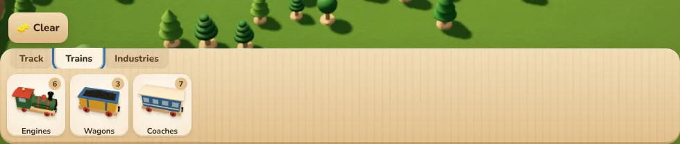
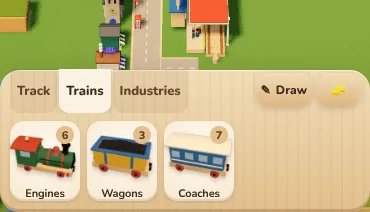
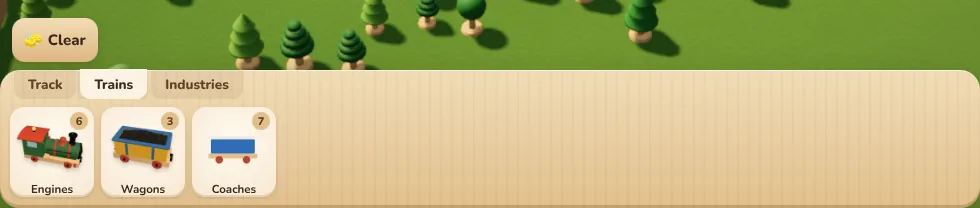
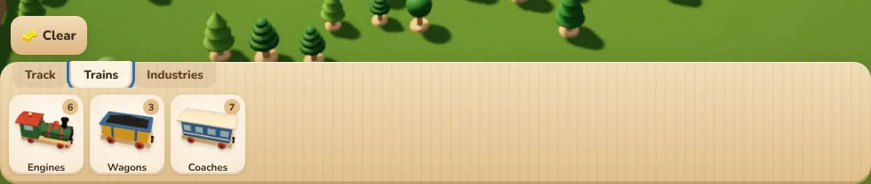
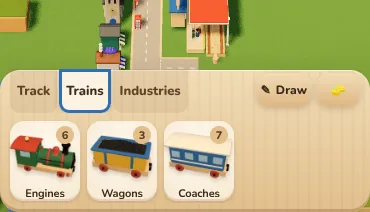
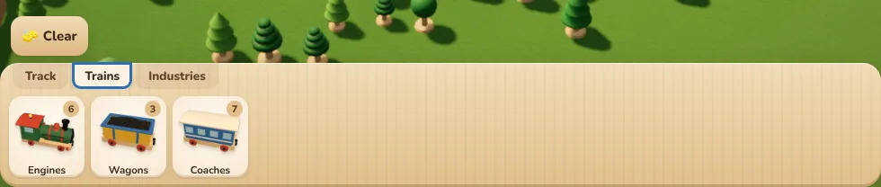

# Tray tab focus ring (2026-11-01)

The user's report: a blue bracket around the selected tray tab ("Trains") after a mouse click, lapping onto
Track and Industries and cut off at the top and bottom by the tab strip.

Why: the ring was `:focus-visible` with `outline-offset: 2px`. Chrome turns `:focus-visible` on for a clicked button as
soon as any key is pressed, and the game takes keys all the time (the camera, shortcuts). The 2px offset put the
ring outside the tab, where the strip's scroller (`overflow-x: auto`) clipped its top and bottom.

Fix (`src/style.css`, `src/ui/focus-ring.ts`): the ring shows only while focus is moved by Tab (`.kbd-nav` on the root,
until the next pointer press), and is drawn inside the control (`outline-offset: -3px`). One rule for every control:
the tray tabs, the Journal's tabs, research board nodes, card and ticket chip buttons, the school and workshop chips.
Checked by `npm run e2e:focus-ring` (14 of its checks fail on the old CSS).

| | 390 | 1440 |
|---|---|---|
| Before, clicked then a key |  |  |
| After, clicked then a key |  |  |
| Before, keyboard |  |  |
| After, keyboard |  |  |
