# Route creation and editing: a UX audit, 2026-11-02

The question was: "how is our route editing experience?" Later the scope was widened to cover **creating** routes and lines from nothing as well as editing them. This is an audit only. No code was changed.

**Short answer.** For someone who already knows where it is, it works well. Making a two-stop route takes 5 taps. The stop chips show what is picked up and dropped. The card's error lines say what to do next. The problems are in **finding** it and in **getting out of mistakes**:

- Nothing leads a player to routes, and a route can only be started from a train.
- Via points can't be found by chance on touch.
- Stop modes are hidden in a button that cycles, and with three stops or more its 4th tap turns the stop into a via.
- Route edits can't be undone. Leave on a line's only train deletes the line at once.
- With several lines, the ribbons can't be told apart (or can't be seen at all) at the zoom where you'd compare them.

## How this was done

- **Map.** `src/play/bugmaps/route-stuck.txt`, the user's own mid-game map from the 2026-11-01 play-test, loaded with the dev-only `#load=`. It has six towns, two forests, a sawmill, a farm, a mill, a school, a workshop, a ring with passing loops, four trains and one line (Red, farm ⇄ mill). Train routes is already learned.
- **Browser.** Headless Chromium (SwiftShader), driven with touch on phones and the mouse on desktop. Viewports: 390×844 portrait, 844×390 landscape and 360×740 (phones, DPR 1.5), and 1440×900 desktop.
- **Script.** Temporary, not committed, in the style of `tools/e2e/warehouse.mjs`. Everything under test was done by taps: the engine, the card's buttons, stations and track on the map, and ☰ → Lines.
  - **Shortcuts:** the game was paused so the pictures hold still, and one piece was taken up through `editor().remove` for the track-edit check. The three-line pictures (20, 21) were set up with `editLine`.
  - **Pans:** where a target wasn't on screen and clear of the HUD, the script glided the camera there and counted it as a **pan** the player would have had to make.
  - **Scrolls:** where a button was covered or off its card, it was scrolled into view and counted as a **scroll**.
- **Measured from the page:** taps, pans, scrolls, the card's text at every step, every button and chip under 44 px, and clipped text.
- **Impeccable.** `critique` and `audit`, scoped to route UI: the engine card's route section, the planning bar, stop and via chips, the Lines view and the ribbon. Run in one context (⚠️ DEGRADED: no second assessor). The detector was run on `src/style.css`.
- **Discovery times are estimates, not measurements.** Nobody new to the game was watched. Each estimate comes from walking the path cold (what's on screen, what a tap reveals) with keystroke-level timings: about 1.4 s to think before each step, 0.3 s a tap, 2–5 s a pan or search. The ranges are wide where a player has to guess.

Pictures are `<viewport>-<step>.webp` in this folder.

## Tap counts

From the four runs. They were the same in every viewport unless a cell says otherwise.

| Task | Start | Taps | Pans | Notes |
|---|---|---|---|---|
| **Create a route from nothing (2 stops)** | map, train in view | **5**: engine, Plan a route, stop A, stop B, Done | 2 | The route is live after B; Done only brings the card back |
| Create a route starting from a stop | the stop's card | **not possible** | — | Industry cards have nothing about routes; a town card's line chips open Lines, which has no "New line". Close the card, find a train, then do the 5 taps |
| Add a 3rd stop at the end | engine card open | 3: Edit, the place, Done | 1 | |
| Put a new stop in the middle | engine card open | 3 + 1 + n: add it, pick its chip, ◀ n times | 1 | New stops always go at the end |
| Move a stop one step earlier | engine card open | 2: chip, ◀ | 0 | Landscape: +1 scroll inside the card |
| Remove a stop | engine card open | 2: chip, ✕ | 0 | |
| **Set a stop to Only drop** | engine card open | **2**: chip, "Automatic" | 0 | From the map, 3. Landscape: +1 scroll. Only pick up is 3; back to Automatic is 4 |
| **Add a via** | engine card open, route exists | **3**: Edit, the track, Done | 1 | |
| Remove a via | engine card open | 2: via chip, ✕ | 0 | Landscape: +1 scroll |
| Second train joins a line | map | 2: engine, the line's chip | 1 | |
| Rename a line | engine card open | 2 and typing: the line's name, the name field, Enter | 0 | From ☰: 3 and typing |
| Recolour a line | map | 4: ☰, Lines, swatch, colour | 0 | |
| Take a train off its line | engine card open | 1: Leave | 0 | 2 only for a renamed line's last train |

No step needed a target smaller than 44 px. Nothing in the card or the Lines view was clipped at 360 px.

## How long each takes to find (estimated, first time, no help)

| Task | Estimate | Why |
|---|---|---|
| Know that routes exist | at the toast, or never | Learning *Train routes* toasts "Learned Train routes! Give a train its stops…" for 3.8 s. No goal uses routes, and nothing points at the engine card |
| Find "Plan a route" | 10 s to 5 min after learning | Only on the engine card, under Go and the row of buttons. Players who tap trains find it quickly; those who run trains by the levers may never open the card |
| **Create a route from nothing** | **1–6 min** in all | The two above, then "Tap stations and depots, in order" (clear), then Done |
| Create a route from a stop or the Lines view | never | No way in |
| Stop options (move, mode, ✕) | about 15 s | "Tap a stop for options", shown until a chip is tapped |
| **Only drop** | 30 s to 3 min | The button says "Automatic": a state, not an action. Nothing says that tapping it changes the mode. Its tooltip is on hover only |
| **Via point** | unlikely to be found on purpose | On touch there's no visible hint. The Plan button's tooltip ("and track, to go that way") is hover only, and the toast "Tap a station or depot first, then the track to go by" only shows after tapping track with no stops. Most will find vias by a stray tap ("Via point: the train goes this way…") |
| Join a line | about 10 s | "Or run a line:" with its chips is in plain view |
| Rename or recolour a line | 1–5 min, often never | The line's name on the card opens Lines, but it looks like a label. ☰ → Lines is the other way |

## Walkthrough

### 1. A first route

| Engine card, no route (390) | Planning, empty | Two stops | After Done |
|---|---|---|---|
| 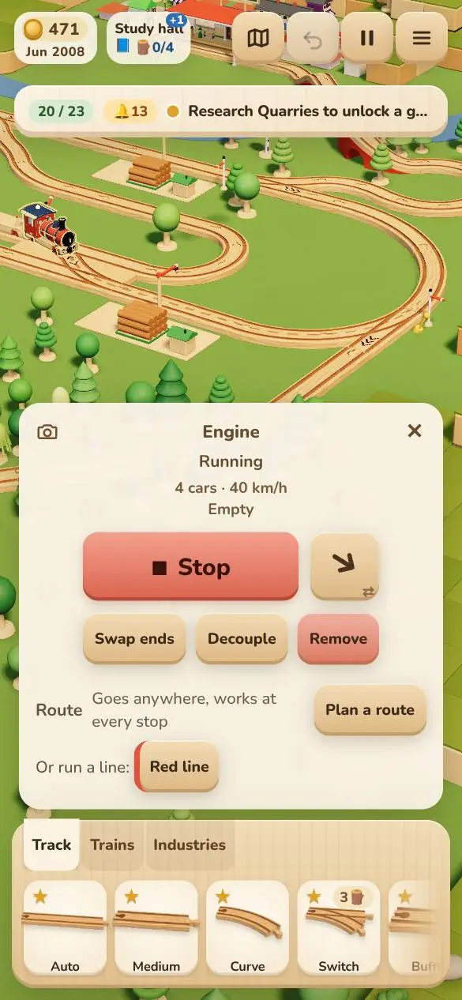 | 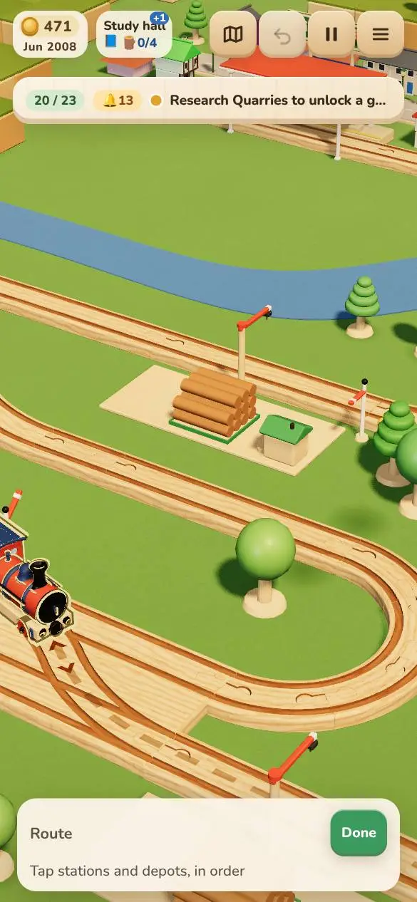 | 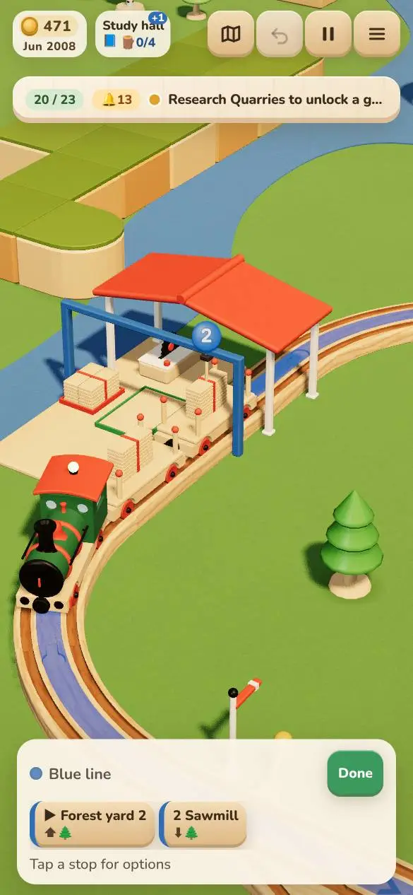 | 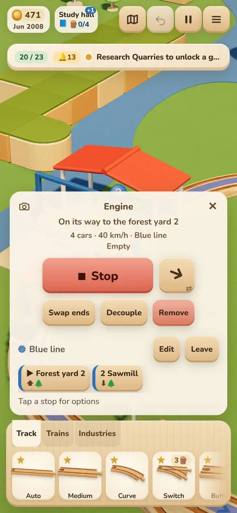 |

**Works:**
- Planning slims the card to a bar, hides the tray and frames the nearest places.
- "Tap stations and depots, in order" says exactly what to do.
- Each stop gets a numbered disc on a post.
- The line is named and coloured for you (Blue line).
- The ▶ goes to the stop the train comes to first. The status changes at once ("On its way to the forest yard 2").

**Problems:**
- **Each tap glides the camera to the place just tapped** (`keepInView`). By the second stop you can't see the first, the train, or the ribbon between them (05). Planning never shows the whole route.
- **After Done, the card is back at full height and covers the route.** In portrait it fills the lower 60%, and the camera stays close in on the last stop (06). You don't get to see what you made.
- **"▶" means two things.** In a chip it marks the stop the train is heading for. In the tools under it, ▶ means "visit later" (07, 13). After a second train joins, its card swaps the number for ▶ ("1 Forest yard 2 · ▶ Foxley", 16), so the order is lost on the chip it would matter on.
- **Names with numbers clash with stop numbers:** "▶ Forest yard 2 | 2 Sawmill".
- **Desktop:** "Route … Done" sits at the bottom centre, a long way from the map's action (desktop-03). Fine on its own, but there's no Enter for Done.
- **Landscape:** the planning bar takes the top right third, under the top bar (landscape-05). It covers anything to the north-east, so more panning is needed.

### 2. Stops: options, modes, the ⬆/⬇ icons

| A stop picked | Only drop | 360 px | Landscape: tools off the card |
|---|---|---|---|
| 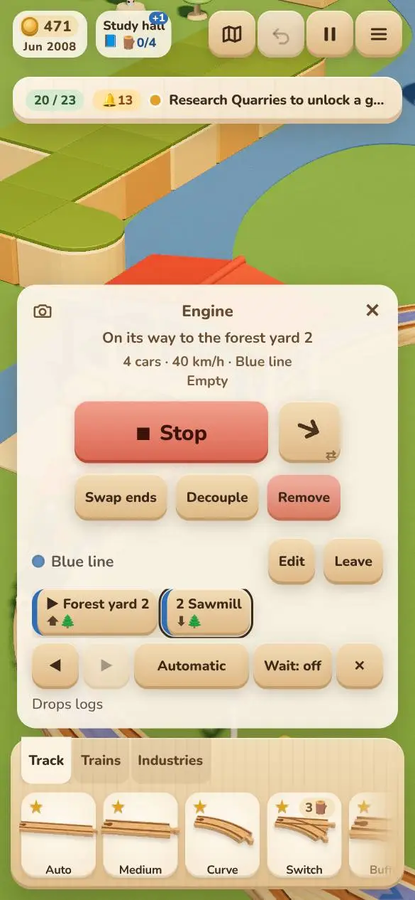 | 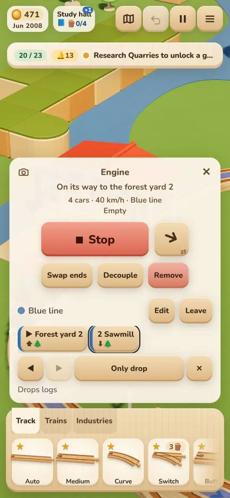 | 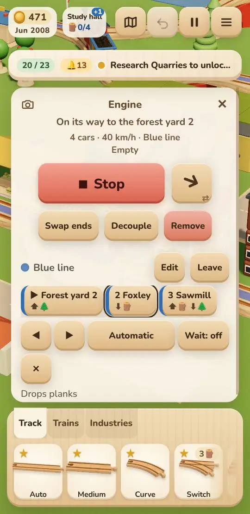 | 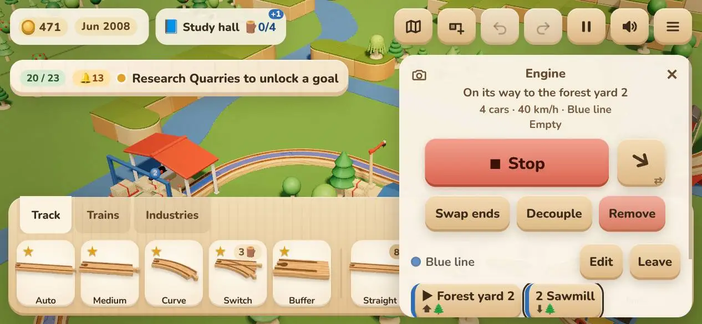 |

**Works:**
- The goods icons under each chip ("⬆🌲", "⬆🪵 ⬇🌲") come from the economy's own plan, and "Drops logs" in words under the tools.
- Moves the order can't take are disabled, not hidden.
- At 360 px the row wraps cleanly. ✕ goes to its own row; awkward, but nothing is clipped.

**Problems:**
- **The mode is a button that cycles,** labelled with the current state: Automatic → Only drop → Only pick up → … You can't see the three choices together.
- **With three stops or more, the tap after "Only pick up" turns the stop into a via ("Pass by")** and takes it off the route (`passBy`, main.ts). Nothing on the button warns of it.
  - (With two stops it goes back to Automatic, as the run showed in 08c.)
  - It's the most likely way to lose a stop by accident.
- **"Wait: off"** doesn't say what it waits for. It also vanishes when the stop is Only drop, which shifts the row.
- **⬆ and ⬇ are ambiguous.** Is ⬆ "up into the wagon" or "up the line"? The words appear only once a stop is picked. The chip's own "↓"/"↑" for a stop's mode is set in CSS but hidden when there are goods icons (`.has-goods[data-intent]::after { content: none }`). So an Only drop stop looks the same as an automatic one until tapped (08 vs 06).
- **Landscape:** the stop's tools sit below the card's fold. 3 of the 8 editing tasks needed a scroll inside the card (landscape-07).

### 3. Via points

| Via added while planning | Via picked |
|---|---|
| 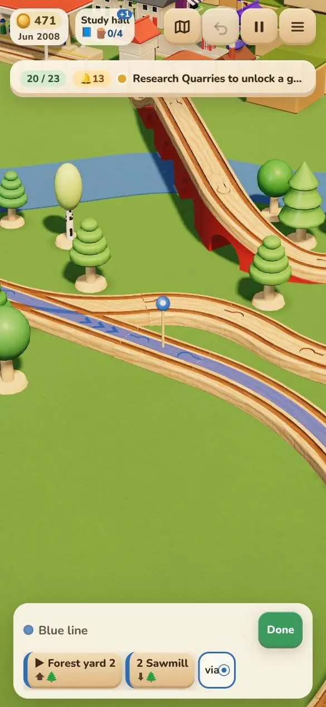 | 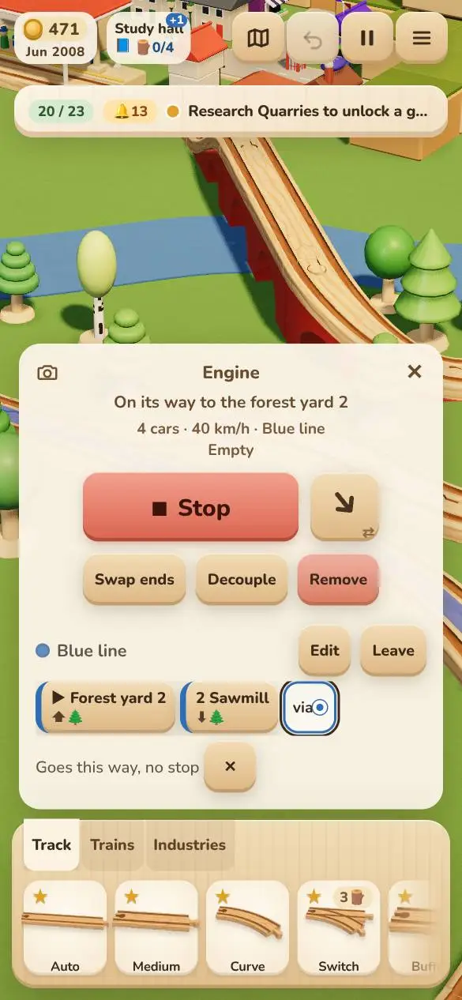 |

**Works:**
- A clear toast ("Via point: the train goes this way, without stopping").
- A small disc with a white dot on a post, and a "via ●" chip.
- Picked, it says "Goes this way, no stop" and offers ✕. For a station it also offers Stop here.

**Problems:**
- **Hard to find** (see the discovery table above).
- **A stray tap adds a via.** While planning, a tap that misses a station and lands on track just next to it adds a via, not the stop.
- **A tap on a train standing on the track does nothing,** so you can't put a via where a train stands. The first run tapped the wagons and nothing happened.
- **The chip says only "via".** It doesn't say where, and picking it doesn't show it on the map. With two or more vias they can't be told apart.
- **Vias are only added after the last stop** (`onPickVia` adds them on the way from the last stop). For a via between stops 1 and 2 of a 3-stop route: remove stop 3, add the via, add stop 3 back. Or tap a via that's already there.

### 4. The ribbon

| Close (desktop) | Three lines, Lines view | Lines view, mid zoom |
|---|---|---|
| 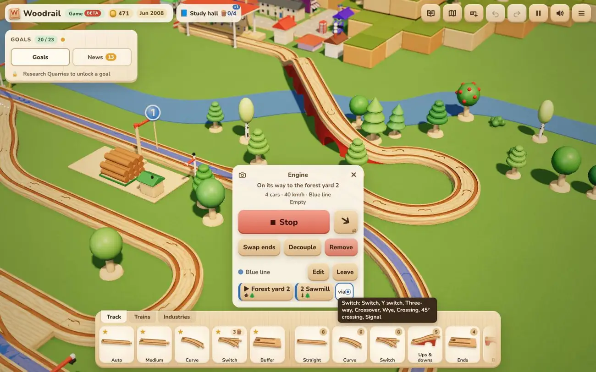 | 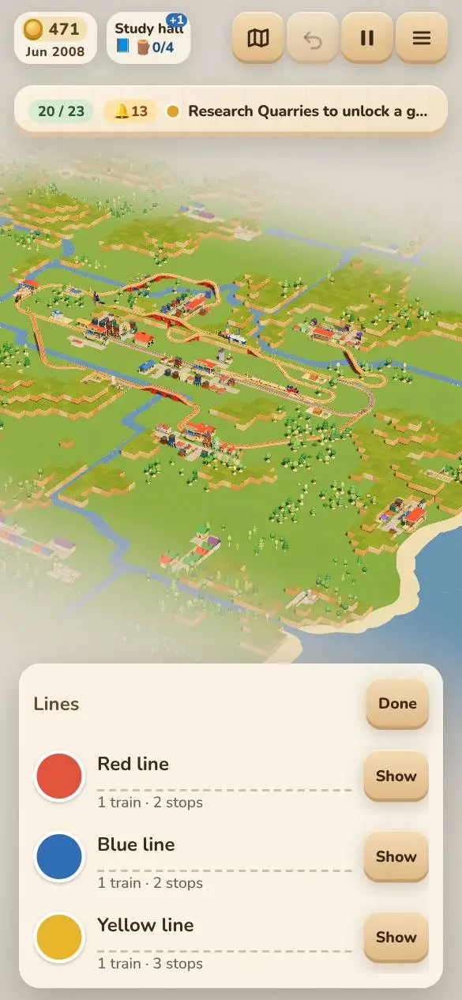 | 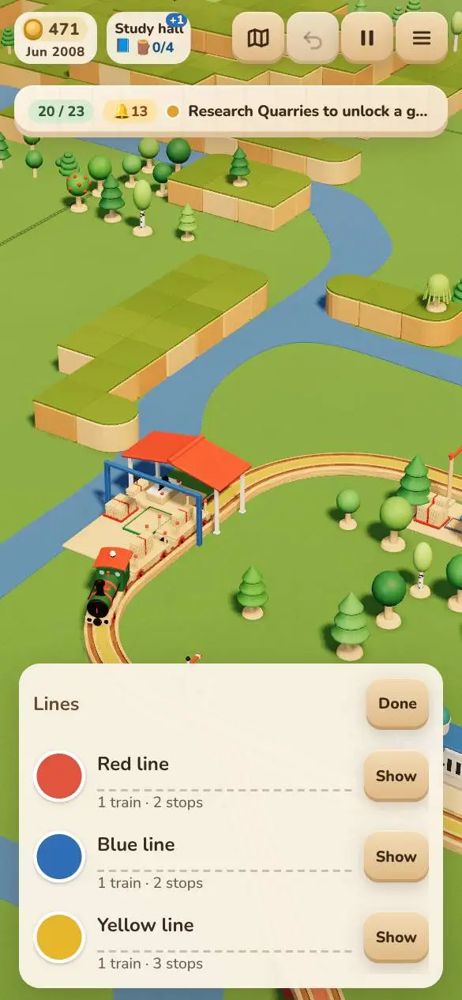 |

**Works:** close up, the ribbon lies in the grooves and reads as the way the train will go (desktop-10). The stop discs keep one size on screen and fan out.

**Problems:**
- **No direction.** There are no arrows. A shuttle A ⇄ B and a ring A → B → A look the same. You can't tell which way round a loop the train goes.
- **Several lines at once can't be seen.**
  - The Lines view frames the whole board, where a 14 mm ribbon is under a pixel (20).
  - At mid zoom the yellow line is a faint tint and the others don't show (21).
  - The Lines view draws no discs or labels, so the map doesn't say which line is which.
- **Line colours against the track.** Contrast against beech (`#e7c89a`), before the ribbon's 0.85 opacity:

  | Colour | Contrast |
  |---|---|
  | Yellow | 1.2:1 |
  | Orange | 1.9:1 |
  | Teal | 1.9:1 |
  | Green | 2.2:1 |
  | Red | 2.4:1 |
  | Pink | 3.0:1 |
  | Blue | 3.3:1 |
  | Purple | 3.4:1 |

  Five of the eight are under 2.5:1.
- **Two lines on the same track** are drawn one over the other, not side by side.

### 5. Lines: joining, colours and names

| Join offer (2nd train) | Joined | Lines | Palette |
|---|---|---|---|
| 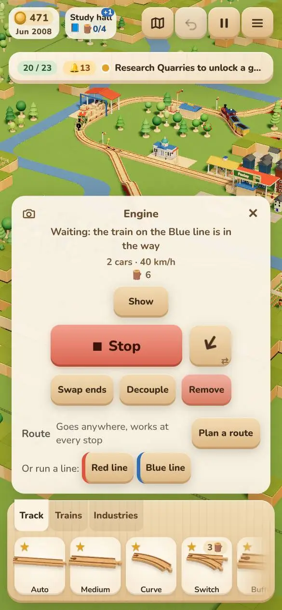 | 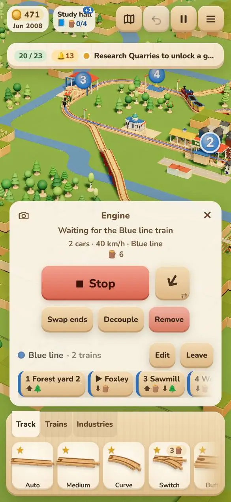 | 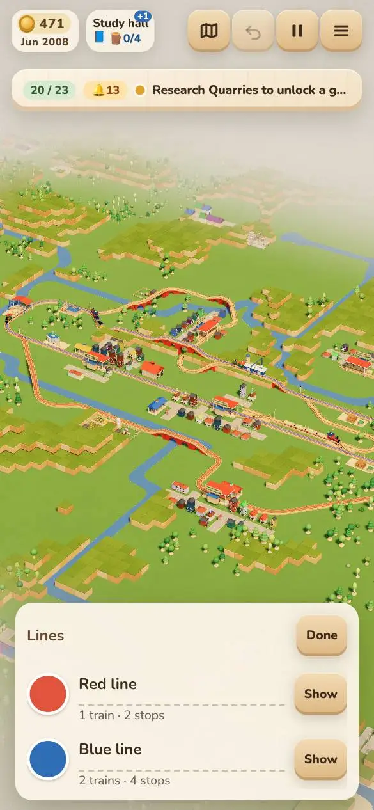 | 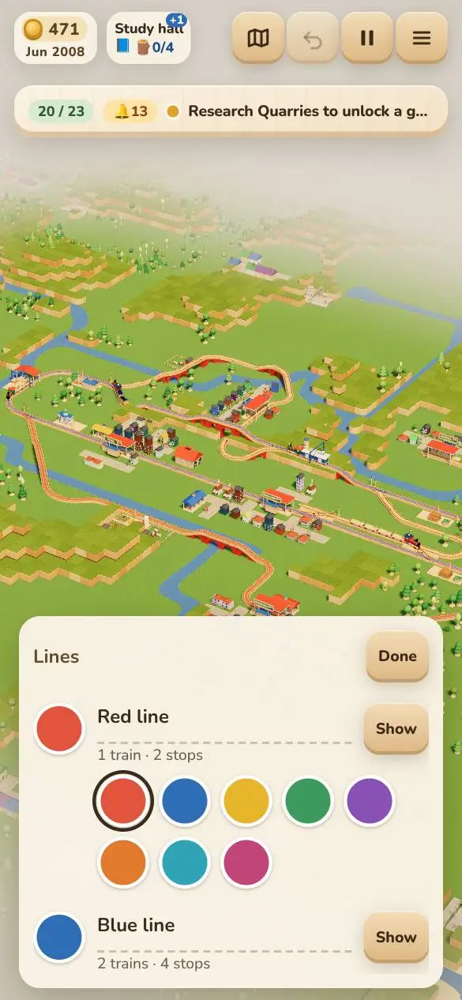 |

**Works:**
- "Or run a line:" with chips in the line's colour (lines no track reaches are greyed, with a reason).
- "Blue line · 2 trains".
- "Changes the line for all N of its trains" while editing a shared line.
- The palette is big and clear.

**Problems:**
- **The Lines view only renames and recolours.** It has no "New line", no "Add a train", no "Edit stops", and no way to take a line away.
  - Show frames the line's places, but nothing to edit opens from there.
  - A line can't be copied or reversed.
- **The name field looks like a label.** The dashed underline is the only hint that it can be typed into.
- **The line's name on the engine card opens Lines,** but nothing shows that it's tappable. The hint is a hover tooltip.
- **Starting a new line for a train already on one takes two steps:** Leave, then Plan a route. Leave on a default-named line's only train deletes it straight away (see §8).

### 6. Track edited under a route

A switch on the Blue line's way was taken up (portrait-19). The train went round the other way of the ring at once. The card didn't change ("On its way to the forest yard 2"), and nothing said the way had changed.

- **Good:** routes now stay put, as intended.
- **Missing:** a line on the card, or a moment of ribbon flash, saying "Goes the other way round now". The player sees a train go somewhere new and doesn't know why.
- **No way at all:** the card shows "Can't reach Mill: no track leads there", and the map draws red dashes over the gap. That state was read from the code (main.ts `cantReach`), not captured in a picture.

### 7. Feedback: why a train isn't loading or dropping

These are read from `engine-status.ts`, `workshop-text.ts` and `warehouse-text.ts`. One was seen live ("Waiting for the Blue line train", 16, with **Show**).

- **Good:**
  - Every line names the place and the fix: "Not dropping planks: Foxley isn't on this route. Edit the route to add a stop here", and "Warehouses trade with trains on a route. Plan a route with a stop here".
  - The stuck cards name the train in the way and offer Show.
- **The gap:** "Edit the route to add a stop here" sends you to Edit, then a tap on that place. One button on the status line, "Add Foxley", would do it in one tap.
- **The word "route" is used for two things.** The texts say "route"; the card and Lines say "line". A child sees "Blue line" on the card and is told to "edit the route".

### 8. Undo, mistakes, leaving, sizes

- **Route edits can't be undone.**
  - While planning, the top bar's Undo is disabled (measured).
  - Ctrl+Z did nothing to the route, which kept its 4th stop.
  - After Done, Undo undoes the last *track* edit, not the route.
  - `editLine` isn't in the editor's history.
- **Leave on the last train of a default-named line deletes the line at once,** with all its stops and vias, and no undo. Only lines the player has renamed ask "Forget …?" first.
- **Leaving planning:** Done, Esc on desktop (it closes the card), or a tap on another train. The card's ✕ is hidden while planning, and a tap on open ground doesn't leave. That is consistent, but the only exit on a phone is Done.
- **Sizes:**
  - Every button and chip in the route UI and the Lines view is at least 44 px, in all four viewports.
  - Nothing is clipped at 360 px. The stop strip scrolls sideways with faded edges (16).
- **Esc doesn't close the ☰ menu** (a side finding).

## Critique (Impeccable, scoped to route UI)

⚠️ DEGRADED: single-context (one assessor, no second sub-agent pass). Method: design review from the screenshots and the code. The detector was run on `src/style.css`.

| # | Heuristic | Score | Key issue |
|---|---|---|---|
| 1 | Visibility of system status | 3 | Discs, ▶, goods icons and the live status are good; no direction on the ribbon, and a silent reroute when track changes |
| 2 | Match with the real world | 3 | Kid words throughout; "via", "Wait: off" and ⬆/⬇ need reading; "route" in texts and "line" on the card |
| 3 | User control and freedom | 1 | No undo for route edits; Undo disabled while planning; Leave deletes a line with no undo |
| 4 | Consistency and standards | 2 | ▶ means next and later; a cycling state-button beside an on/off toggle; Done is a green off the system (`#3c9a5f`, white text) |
| 5 | Error prevention | 2 | The mode cycle turns a stop into a via; a stray track tap adds a via; Leave isn't guarded |
| 6 | Recognition over recall | 2 | Vias, stop modes and renaming are all hidden until you know them |
| 7 | Flexibility and efficiency | 2 | No inserting between stops, no drag to reorder, no starting from a stop, no copying or reversing a line; Esc is the only shortcut |
| 8 | Aesthetic and minimalist design | 3 | The planning bar is compact and on-brand; the card hides the route after Done |
| 9 | Error recovery | 3 | Can't reach, Not dropping and the stuck cards say the fix and offer Show |
| 10 | Help and documentation | 2 | One-time hints only; no goal teaches routes; via help is hover only |
| | **Total** | **23/40** | **Acceptable** |

**Design specificity: strong.** Chips with a lacquer edge in the line's colour, discs on posts like station signs, and the ribbon in the grooves all belong to this toy. The structure (a card with a chip strip and a tools row) is generic, but that's right for an Operate surface.

**Detector:** 11 anti-patterns, 2 of them in route UI. `.route-chip` and `.route-join-line` have a 5 px coloured left border, which the detector reads as an "AI side tab".
- **Partly a false positive:** the stripe carries the line's colour, a real key.
- **But it's the chip's only colour,** and the stripe is narrow on a phone. A full lacquer cap or a coloured disc would read better (fix F11).
- The rest is design-system drift: `#3c9a5f`, `#b0391f` and `#e6b52c` aren't DESIGN.md tokens.

**What's working:**
1. The goods icons under each stop, from the economy's own plan.
2. Error and stuck text that says the fix and has a Show button.
3. Planning as a slim bar over the map, with the tray put away.

**Personas:**
- **A child (6–9), first time:**
  - won't read the research toast;
  - doesn't know "via";
  - taps "Automatic" twice and the stop is now "Only pick up", with no idea what changed on the map;
  - taps Leave and the line is gone.
- **A returning adult (OpenTTD-style):**
  - wants to insert a stop between two others, drag to reorder, see direction, copy a line for a second train set, and undo;
  - gets none of these;
  - will build routes, but slowly, and will dislike losing a line to Leave.
- **A phone held sideways:** three of the eight editing tasks need a scroll inside the card, and the planning bar covers the north-east of the map.

## Audit (Impeccable, scoped to route UI)

| Dimension | Score | Findings |
|---|---|---|
| Accessibility | 2 | **Contrast:** Done is `#fff` on `#3c9a5f` (3.5:1, under 4.5 for 15 px text); a lost stop's chip is 0.55 opacity (2.9:1); most line colours are under 2.5:1 on beech. **States:** the picked stop and the next stop aren't exposed (no `aria-pressed` or `aria-current`). **The mode button** announces only its current state, not that it changes it |
| Performance | 4 | Card and ribbon rebuild on a key of their inputs; nothing per frame; ribbons built once per change |
| Theming | 2 | Hard-coded route colours outside DESIGN.md (`#3c9a5f`, `#b0391f`, `#e6b52c`, `rgba(255,255,255,.55)`); the Done green isn't the system's go-green |
| Responsive | 3 | All targets ≥ 44 px and no clipping at 360 px; in landscape the stop tools are below the card's fold |
| Implementation integrity | 3 | The stop-mode cycle that quietly removes a stop (`passBy`) is the main behavioural defect |
| **Total** | **14/20** | **Good** |

## Proposed improvements, in priority order

**Sizes:** Quick is a day or less; Medium is 2–5 days; Big is more than that, or needs design. "Benefit" is what the player gets from it.

| # | Fix | Size | Expected benefit |
|---|---|---|---|
| **F1** | **Undo for route edits.** Put `editLine`, join and Leave through the editor's history (as `editProps` does), and keep Undo enabled while planning | Medium | Every mistake can be taken back; it also makes F2 and F3 safe. Fixes heuristic 3 (1 → 3) |
| **F2** | **Stop mode as three choices, not a cycle:** a segmented "Drop & pick up · Only drop · Only pick up", with **Pass by** as its own button. The current mode also shows on the chip (bring back ↓/↑ next to the goods icons) | Quick | Only drop drops from 2 taps and a guess to 2 taps you can see; ends the accidental stop → via |
| **F3** | **Guard Leave on a line's last train** (any name): "Forget Blue line?" on a second tap, as renamed lines have now; better still, Undo (F1) | Quick | Stops a 1-tap loss of a whole line |
| **F4** | **A way into routes for new players:** a goal after *Train routes* ("Give a train a route", with Show me pointing at a train), and the learn toast saying "Tap a train, then Plan a route" | Quick (text) / Medium (goal and play-through) | Finding routes goes from "maybe never" to under a minute; the goal is reached in the play-through by the player's path (AGENTS.md) |
| **F5** | **Show the whole route while planning and after Done.** Frame all stops (not each new one) as stops are added; after Done, glide once to frame the line above the card | Quick | The player sees what they made; fewer pans (2 → 0 in the 2-stop case) |
| **F6** | **Make vias findable:** add "· tap track to go that way" to the planning hint once there's a stop; a "+ via" chip after the last stop that, tapped, says "Now tap the track to go by"; picking a via chip glides to it and flashes its disc | Quick | Vias go from found by accident to found on purpose; vias can be told apart |
| **F7** | **Stop ▶ meaning two things.** Use a filled number for the next stop (or a 🚂 badge), and ← / → or a drag handle to move a stop | Quick | Stops the main misreading on the card |
| **F8** | **Direction on the ribbon:** small chevrons along it, spaced, pointing the way the train runs, and two-way legs shown as two thin lanes | Medium | Loops and shuttles read at a glance; you can see which way round |
| **F9** | **Lines that can be read together:** in the Lines view, draw ribbons wider with zoom (a screen-space minimum, as the discs have), each line's discs, and a name tag on each; where lines share track, draw them side by side | Medium | The Lines view is useful for comparing lines, not just naming them |
| **F10** | **Line colours that show on wood:** a dark outline under each ribbon (or darker shades for yellow, orange and teal), aiming for ≥ 3:1 against beech | Quick | All eight colours visible on track |
| **F11** | **Clearer line-colour key on chips:** a lacquer cap or disc in the line's colour, not the 5 px left stripe | Quick | Reads as a toy block; clears the detector |
| **F12** | **Start a route from a place:** on a station's or depot's card, "Trains here" (the lines calling) and "New route from here" (pick a train nearby, then plan with this as stop 1). The Lines view gets "New line" and "Add a train" | Big | Creation from either end; a natural way in for players who think in places, not trains |
| **F13** | **Insert stops where they go:** in planning, a picked stop's chip means "add after this"; or drag chips to reorder | Medium | Putting a stop in the middle: 4+n taps → 3 |
| **F14** | **Feedback when the way changes:** after a track edit, if a line's way changed, flash its ribbon once and put "Goes another way now" on its card for a few seconds | Medium | No mystery trains after track work |
| **F15** | **One-tap fixes on the status line:** "Not dropping planks: Foxley isn't on this route" gets an "Add Foxley" button | Quick | The fix the text already names, in 1 tap instead of 3 |
| **F16** | **Landscape: no scroll for stop tools.** When a stop is picked, scroll the card to its tools, or dock the tools under the chip strip so they're always in view | Quick | Landscape editing tasks lose their extra scroll |
| **F17** | **Words:** "Wait: off" → "Wait to fill: off"; "route" in status texts → "line" where the train is on one; a ✎ on the line's name on the card; avoid "Forest yard 2" next to "2 Sawmill" (put the place number in a lighter weight, or call them "the second forest yard") | Quick | Fewer things to read twice |
| **F18** | **Contrast and tokens:** Done in the system's go-green with dark ink; a lost stop's chip at 0.7 and struck through; route colours as tokens in DESIGN.md | Quick | Passes 4.5:1; keeps to the design system |
| **F19** | **Keys on desktop:** Enter for Done, Delete for the picked stop, ←/→ to move it | Quick | Power users on desktop |

**Order of work.**
- **Batch 1:** F2, F3, F7, F5, F6. All Quick, and between them they fix the four biggest problems.
- **Then:** F1, the important Medium change.
- **Then:** F4's goal, F8–F10 for reading the map, and F12 last (Big).

## Checks to add with the fixes

Each fix should come with an e2e on the player's path that checks the payoff, as AGENTS.md asks, not only that a button showed:

- **F2:** a stop set to Only drop on a 3-stop line delivers there and loads nothing, and tapping the mode three times never takes a stop off.
- **F1:** Undo after adding a stop puts the route back, and the train heads where it did before.
- **F4:** the "Give a train a route" goal is reached in `balance.test.ts` by taps (engine, Plan a route, places).

## After the fixes (re-audit, 2026-11-02)

All 19 fixes are built on `claude/route-ux-fixes` ([roadmap](../../superpowers/specs/2026-11-02-route-ux.md)). Two are partial: F8 has no two-lane drawing for legs run both ways, and F9 doesn't draw lines that share track side by side. Then the walk was done again on the same map (`route-stuck.txt`, `#load=`), by taps at 390×844, 360×740 and 844×390, with the same counting rules. A temporary script; its pictures aren't kept.

⚠️ DEGRADED as before: one assessor, one context. The scores are judged from the walk, the pictures and the code, against the same heuristics.

### Tap counts, before → after

| Task | Before | After | What changed |
|---|---|---|---|
| Create a route from nothing (2 stops) | 5 taps, 2 pans | 5 taps, 3 pans* | Planning and Done frame the whole route (F5), so the route stays in view after the stops |
| Create a route starting from a stop | not possible | **4**: the place, New route from here, the other place, Done | F12 |
| A new line from the Lines view | not possible | ☰, Lines, + New line, then the places and Done | F12 |
| Put a new stop in the middle | 3 + 1 + n | **4**: Edit, its neighbour's chip, the place, Done | F13 |
| Set a stop to Only drop | 2, a guess (cycling) | 2, both visible: the chip, Only drop | F2 |
| Only pick up / back to auto | 3 / 4 | 2 / 2 | F2 |
| Lose a stop by accident (mode taps) | 4th tap, silent | can't: Pass by is its own button and says what it did | F2 |
| Undo a route edit | not possible | **1** (Undo, also while planning, Ctrl+Z) | F1 |
| Take a train off its line's only train | 1, line gone | 2 (asks), and Undo brings it back | F3, F1 |
| Add a via | 3, found by chance | 3 (Edit, track, Done), or 4 with "+ via"; the hint says how | F6 |
| Tell two vias apart | couldn't | numbered chips; picked, the view goes to it and its disc pops | F6 |
| Fix "Foxley isn't on this line" | 3 (Edit, Foxley, Done) | **1** ("Add Foxley") | F15 |
| Landscape stop tools | +1 scroll in 3 of 8 tasks | 0 (scrolled into view) | F16 |

\* The walk counts a pan whenever the place to tap is outside the map's room. Here the first route's forest and sawmill are far apart, and the engine was off screen when it started.

Sizes: every button, chip and field in the route UI, the place cards and the Lines view is 44 px or more, and nothing is clipped, at 390, 360 and 844×390 (measured).

### Discovery, before → after (estimated, as before)

| Task | Before | After | Why |
|---|---|---|---|
| Know routes exist | at the toast, or never | at once | The toast says "Tap a train, then Plan a route" (it no longer gives way to the Next: toast), and the goal "Give a train a route" opens with Show me on the trains (F4) |
| Create a route from nothing | 1–6 min | **30–60 s** | Goal, Show me, the train's card, Plan a route, then the hint says what to tap |
| Create a route from a place | never | ~15 s once the card is open | "New route from here" on every station's and depot's card |
| Only drop | 30 s – 3 min | ~5 s | The three choices side by side |
| Via point | by chance | ~20 s | The planning hint and the "+ via" chip |
| Rename or recolour a line | 1–5 min | ~20 s | ✎ after the name on the card |

### Critique, before → after

| # | Heuristic | Before | After | Why |
|---|---|---|---|---|
| 1 | Visibility of system status | 3 | 4 | Arrows on the ribbon (F8); the next stop's number filled; the mode on the chip; "Goes another way now" and a flash after track work (F14) |
| 2 | Match with the real world | 3 | 3 | "Wait to fill", "line" in the status texts, "Drop & pick up"; "via" is still a word to learn |
| 3 | User control and freedom | 1 | 4 | Every route edit is undoable, also while planning; Leave asks |
| 4 | Consistency and standards | 2 | 4 | ▶ and ← → mean one thing each; Done and toggles in the system's go-green; three choices, not a cycling state |
| 5 | Error prevention | 2 | 4 | No silent stop → via; a stray tap by a station adds the station; Leave guarded |
| 6 | Recognition over recall | 2 | 3 | Modes, vias and renaming all visible; vias still need the hint read once |
| 7 | Flexibility and efficiency | 2 | 3 | Insert after a picked stop, start from a place or Lines, + Train, one-tap Add, desktop keys; no drag to reorder, no copy or reverse of a line |
| 8 | Aesthetic and minimalist design | 3 | 3 | Lacquer number rings, not stripes. Upright, the full card is still tall, and a picked stop adds two rows |
| 9 | Error recovery | 3 | 4 | "Add Foxley" in one tap; the cue when the way changes |
| 10 | Help and documentation | 2 | 3 | A goal, a toast that says how, hints that say what a tap does now |
| | **Total** | **23/40** | **35/40** | **Good** |

### Audit, before → after

| Dimension | Before | After | Why |
|---|---|---|---|
| Accessibility | 2 | 3 | Done 3.5:1 → 4.6–7.8:1 (dark ink on the go-green gradient, each end measured); a lost stop's chip at 0.7 and struck through; ribbon edges ≥ 3:1 on beech for all eight colours (unit test); `aria-pressed` on modes, toggles and "+ via"; `aria-current` on the next stop. Left: the filled number on a yellow line relies on a text shadow |
| Performance | 4 | 4 | Built on change: ribbons, edges and arrows in one show; ribbon width in √2 steps; the flash and pops are a few frames, then 0 |
| Theming | 2 | 4 | Route colours are tokens (`--go-green*`, `--ink-soft`, `--ink-muted`, `--warn-ink`); DESIGN.md has the line colours and the warn ink |
| Responsive | 3 | 4 | No scroll for stop tools on a phone on its side; the tools fit at 360 px |
| Implementation integrity | 3 | 4 | Pass by is explicit; route edits go through the editor's history |
| **Total** | **14/20** | **19/20** | |

### Left for later

- ~~Two lanes for legs run both ways~~ (done on `claude/route-reorder`: each way a thin lane on its left, with its own arrows); ~~lines sharing track drawn side by side (F9)~~ (done too: each line its own lane across the track, the same sides from piece to piece).
- ~~Drag to reorder stops~~ (done on `claude/route-reorder`: hold a stop's chip, drag, a bar shows where; Undo); ~~copy or reverse a line~~ (done: Copy and Reverse on each line in the Lines view, undoable).
- The harness makes its line in one call (`startLine`). Made tap by tap, the play-through drifts: the mine opens at minute 173, not after 220. Left for a balance pass (the CoS, 2026-11-02).
