# QA — play-test 2026-11-05 (batch F + underpasses)

Branch `claude/qa-2026-11-05` from origin/claude/batch-fg `c523524`. Played on a 4-core cloud container in headless
Chromium (SwiftShader), driven by Playwright. Phone context 390×844 with touch (360×740 for one layout check), Game
mode, starting from a fresh map. Shots are in `docs/qa-2026-11-05/`.

## Verdict

**PASS WITH NOTES.** No page errors. The new chains I played pay off:
- **Oil:** an oil well made at the workshop by taps, then dragged from the tray. Track drawn from it to Elderwick with
  Draw. An engine and two Tank wagons dragged onto it, and a route planned by taps. 14 loads and 11 unloads of oil in
  about 2 sim-minutes, "First oil!" toast, and coins went up at 9 per unit.
- **Breakdown crane:** a crane train standing idle on no line drove out round the loop to a derailed train, lifted it
  and set it back on the track, with toasts.
- **Depot tracks:** checked with the fix (#3) on an oil well: Second track by tap, crossovers, a gantry over both.

Two bugs are fixed on `claude/qa-fixes-1105` (#1, #3). The rest are design notes or small items.

| # | Severity | Finding | Fixed? |
|---|---|---|---|
| 1 | Medium (bug) | "Send the crane" offered when the only crane is the train in the way; a tap says "Put a breakdown crane on the track first" | yes |
| 2 | Medium (design) | After a rescue the crane train stays where it stopped, on the line, in the rescued train's way; the rescued train is left Stopped | no |
| 3 | Medium (bug, merge gap) | Sidings' Second/Third track missing on every batch F industry (oil well, water pump, sugar beet, jam, chocolate, flowers, dye works, toy workshop) | yes |
| 4 | Low | Jam kitchen's ticket offers a greyed "Research Sugar beet now"; it gives no step the player can take | no |
| 5 | Low (discoverability) | Research tiles show only School/College/University gates: Joinery (30 furniture), Sugar beet / Dye works (a city), Mines show a plain price as if ready | no |
| 6 | Low (wording) | Depot tracks refusal "…at each end: the line ends" on an industry with no track | no |
| 7 | Low (discoverability) | The Industries shelf has 30 tiles; Oil well and Water pump are tiles 23–24, after a run of Locked tiles | no |
| 8 | Low (layout) | The Re-rail chip squeezes the goal bar to "Make up a…" at 390 | no |
| 9 | Low (pre-existing) | About 200 `GL_INVALID_OPERATION … texture format and sampler type` warnings at load, SwiftShader | no |

## How it was played

`scratchpad/q/driver.mjs` was a QA scratch driver (not committed). It kept one browser open and ran steps as modules,
so each step continued the same game.

**By the player's input** (CDP touch, each tap checked with `elementFromPoint`):
- **First goal:** Draw, then a drag between Larkfield and Elderwick ("✓ Join two towns").
- **Research board:** opened, scrolled, and every new tile's ticket tapped: Tank wagons, Breakdown crane, Sidings,
  Reading room, Sugar beet, Jam kitchen, Chocolate factory, Dye works, Toy workshop, Joinery, Mines.
- **Workshop:** dragged from the tray. On its card, + for Oil well, Water pump, Tank wagon ×2, Breakdown crane,
  Sugar beet field, Jam kitchen, Flower field, Dye works and Toy workshop. They are made, the coins are taken, and they
  arrive in the box.
- **Oil line:** the Oil well dragged out; Draw from the well round to Elderwick's free end; an Engine and two Tank
  wagons dragged onto it. Plan a route (Oil well, Elderwick), Done, Go.
- **Crane:** an Engine and a Breakdown crane dragged onto the line. Later, the stuck train's card: Go, then Send the
  crane.
- **Drops:** Water pump, Sugar beet field and Jam kitchen dragged at several spots. Each was refused with a fair reason
  (the yard over a hill block, over a farm's pen, over town lots), and the ghost showed why.

**Harness shortcuts (named):**
- `learn()` for the prerequisites and the batch F research;
- coins set, and the workshop given planks and stone;
- the fast-forward (`sim.tick` and `economy.tick` in chunks);
- camera glides with `director.glideTo`.
- **The derail:** `sim.trackChanged` on the piece under the oil train, as e2e:crane does. The crane's response is
  what was tested.
- **Chain yards (art and card check only):** `editor().place` for the sugar beet, jam, flowers, dye, toys and
  chocolate yards. The editor skips the drop rules, so where these sit (one over the river) means nothing.
- **After-shots for #1:** a staged line (`editLine`, `sim.addTrain`), and the card opened with
  `interaction.openEngineCard`.

**Not covered** by play this run: tunnels, underpasses, low bridges, ring Reverse, Reading room's early collection,
telegraph poles, the chocolate chain's cocoa from boats, and the water pump on a real bank. All of these have their
own repo e2e. Idle frames: the oil well yard drew 0–1 frames in 3–5 s with no train on the map. The pumpjack holds
still then, by the rule in `depot-view.ts`.

## Findings

### 1. "Send the crane" when the only crane is the train in the way: Medium, bug (fixed)
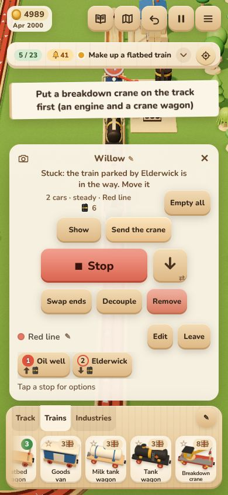

Repro:
1. Make a Breakdown crane at the workshop. Drag an Engine and the crane wagon onto a line that a routed train runs on.
2. Let the crane rescue a derailed train on that line. It parks where it worked (#2).
3. The routed train is now stuck behind it: "Stuck: the train parked by Elderwick is in the way. Move it". Its card
   shows **Send the crane**. Tap it.
4. The toast says "Put a breakdown crane on the track first (an engine and a crane wagon)". There is a crane on the
   track: it is the train in the way.

Cause: `main.ts` showed the button when a crane train other than the stuck one existed. `Breakdown.send` also skips the
target's own train, so the only crane was the blocker and nothing could be sent. Fix: `Breakdown.canLift(blocker,
stuck)` requires a crane train that is neither of them.

### 2. After a rescue the crane parks in the way, and the rescued train is left Stopped: Medium, design
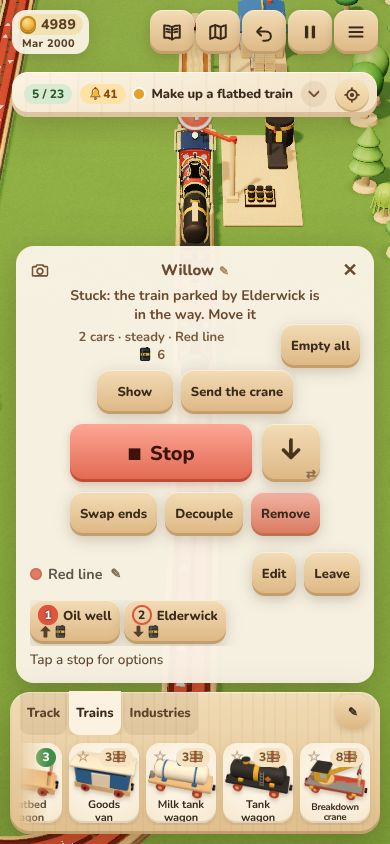 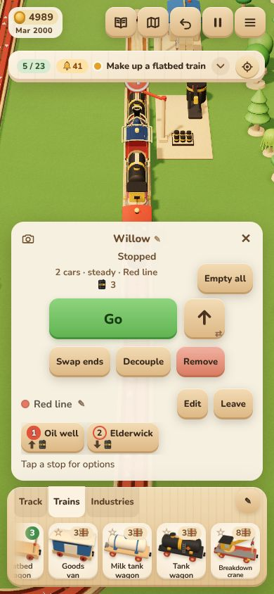

Repro:
1. Set up an oil well → Elderwick route, and stand an idle crane train at the Larkfield end.
2. The oil train derails at the oil well. The crane drives round the loop, lifts it, and sets it down. So far so good.
3. The rescued train sits on its route with every lever off ("Stopped"). Nothing tells the player; the toast only says
   "The crane put the train back on the track".
4. Tap Go. The train runs a short way (about 270 mm), then "Stuck: the train parked by Elderwick is in the way": the crane train
   stayed where it worked, between the train and the rest of its line.

The player has to notice, tap Go, then move or remove the crane train by hand. Re-rail (the chip, or a tap on a car)
also leaves the motor off, so this matches it. But the crane "lifts it back on by itself" and is meant to need no
attention.

Suggestions, for the owner to choose:
- the crane restores the levers the train had before it derailed (a routed train goes on with its route);
- the crane backs off to where it started, or at least clear of the train's way;
- otherwise the toast says "tap Go to set it off".

Also, "parked by Elderwick" names the nearest town while the train stood at the oil well. "Parked by the oil well"
would point to the right place.

### 3. Sidings' extra tracks missing on every batch F industry: Medium, merge gap (fixed)
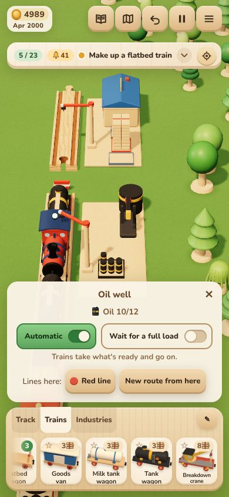 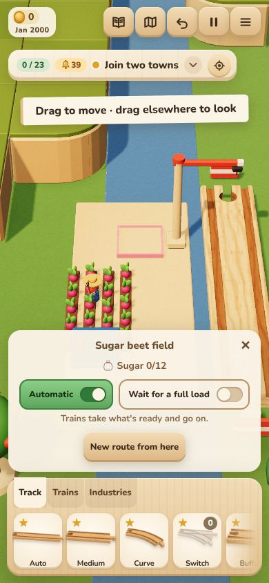

Repro: learn Sidings, then open an Oil well's (or Sugar beet field's, Jam kitchen's…) card. There is no "One track…"
row and no Second track. The sawmill, forest yard and workshop cards have them.

Cause: depot-tracks and tank-crane/goods-chains were built side by side. `TRACK_ROLES` lists only the industries of
the time; the merge added the eight new roles everywhere else but not here. Fixed, with the spec's list updated and a
guard test (every industry piece's role is in `TRACK_ROLES`, except a school and the car factory).

**Question for the owner:** the car factory is left out by the spec without a reason given. Should it have Sidings too?

### 4. Jam kitchen's ticket: a greyed "Research Sugar beet now" with no step the player can take: Low
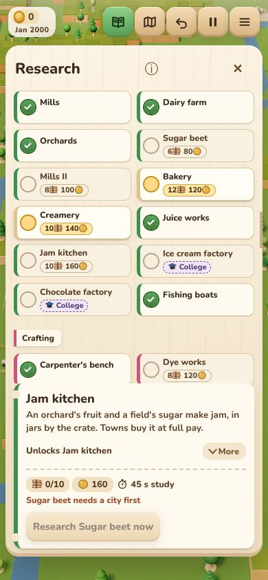

The foot reads "Sugar beet needs a city first", and under it a disabled "Research Sugar beet now". The button reads as
a promise it can't keep. Something like "Grow a town to a city first" would give the step. This seems to be the
existing ticket pattern for a prerequisite's own gate; the new chains (jam, toys, chocolate) just hit it more often.

### 5. Research tiles don't show non-school gates: Low, discoverability
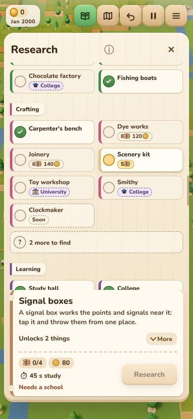 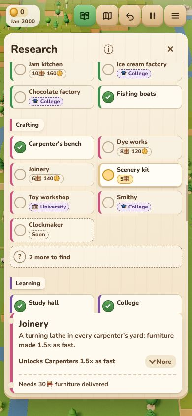

On the board:
- Ice cream and Chocolate show a "🎓 College" badge;
- Joinery shows "6🪵 140🪙", as if ready, but needs 30 furniture delivered;
- Sugar beet and Dye works show their price, but need a city;
- Mines shows "6 10🪨 160", but needs 20 stone and a school by a city.

Only the ticket (after a tap) says why. Joinery and Mines II, Foundry II and Tool works (tech tree 4) add four more
count-gated tiles.

### 6. Depot tracks refusal "…: the line ends": Low, wording
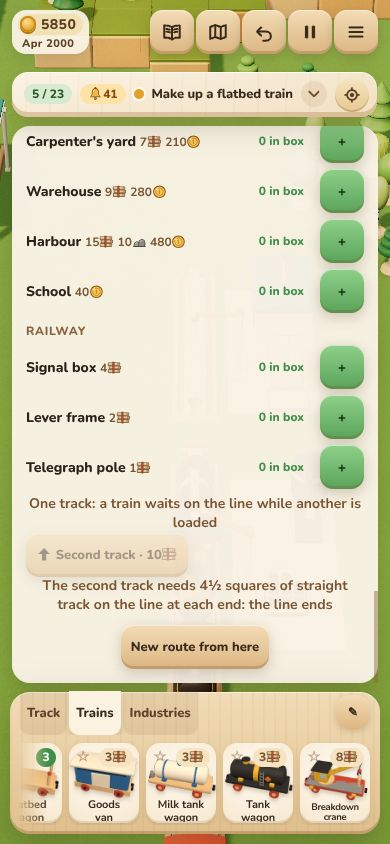

On a workshop or yard with no track joined: "The second track needs 4½ squares of straight track on the line at each
end: the line ends". The same words appear when there is some track that stops too soon. A clearer ending would be
"…: the track stops short there" or "…: lay track there first" (`depot-tracks.ts:112`).

### 7. Industries shelf: 30 tiles, the new wells far along: Low, discoverability
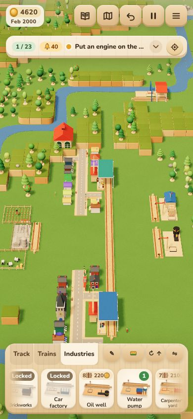

After Tank wagons, the Oil well and Water pump are tiles 23 and 24 of 30, past Creamery, Ice cream, Mine, Foundry,
Brickworks and Car factory (several Locked). A new player told "oil from an oil well" has to swipe about 2,000 px to
find it. Suggestions: put learned tiles before Locked ones, or open the shelf scrolled to the newest learned tile.

### 8. The Re-rail chip squeezes the goal bar: Low, layout
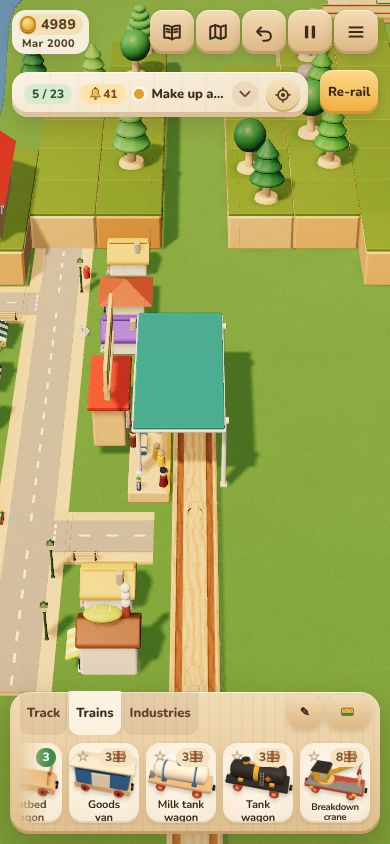

With a derailed train, the orange Re-rail chip sits in the goal bar. The goal shrinks to "Make up a…" at 390.

### 9. WebGL sampler warnings at load: Low, pre-existing
About 200 `GL_INVALID_OPERATION: … Mismatch between texture format and sampler type (signed/unsigned/float/shadow)`
console warnings on every load. The count is the same on origin/main (checked: 200). Most likely the shadow-map
sampler under SwiftShader. Unconfirmed on a real phone GPU. Earlier reports didn't list them because they counted only
errors.

## Also seen (fine)
- The oil line: the train stops at Elderwick, unloads both tanks, runs to the Larkfield end to turn back, and its
  card says "On its way to …" all the way (QA 2026-11-03 #12 holds).
- An idle crane train standing on the line's end: the routed oil train turns back short of it instead of deadlocking.
- The workshop card's new rows (Chocolate factory 12🪵 380🪙, Breakdown crane, Telegraph pole) fit at 360×740.
- The yards' art is in the toy style: beet rows and a shed, the jam cottage, flower rows with hives, the purple dye
  shed, the toy shop, the chocolate-bar roof, and the oil well's pumpjack, tank and barrels
  ([09](qa-2026-11-05/09-oilwell-yard.jpg), [10](qa-2026-11-05/10-chain-yards.jpg)).
- The research tickets read well: Tank wagons, Breakdown crane, Sidings, Reading room. "Learned Reading room! Queue two
  researches…" explains itself.
