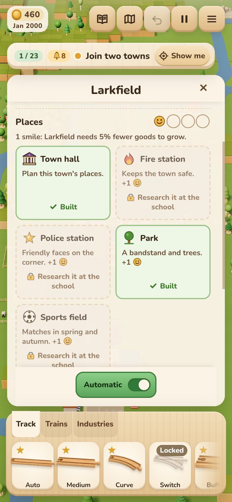
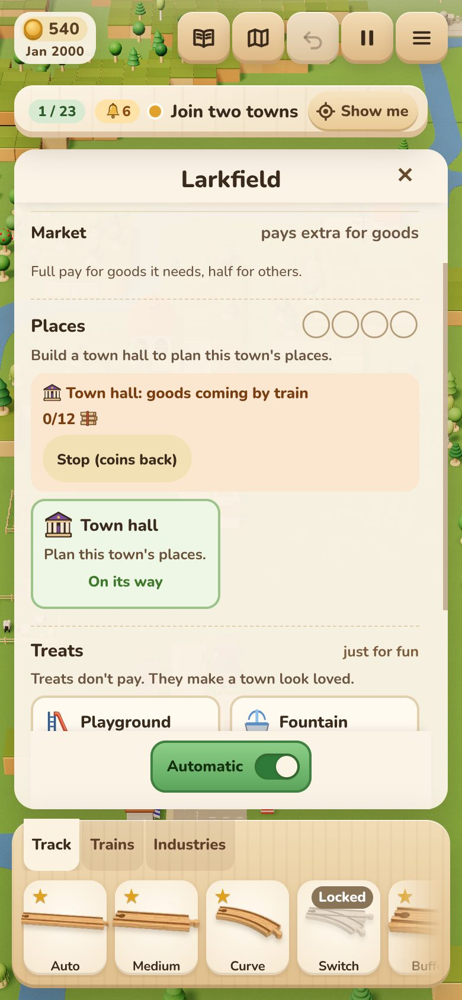
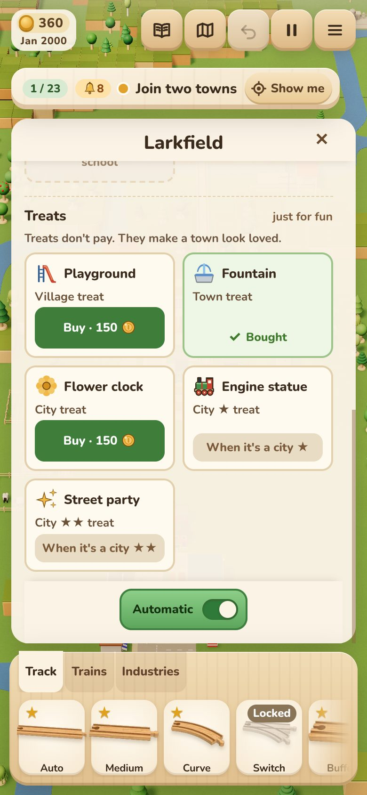
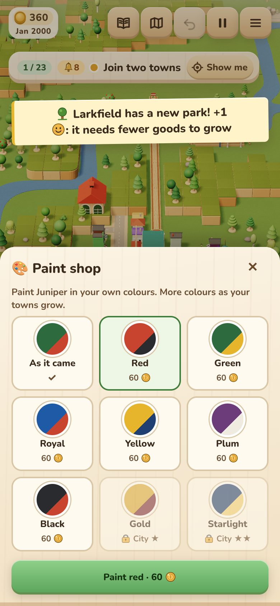
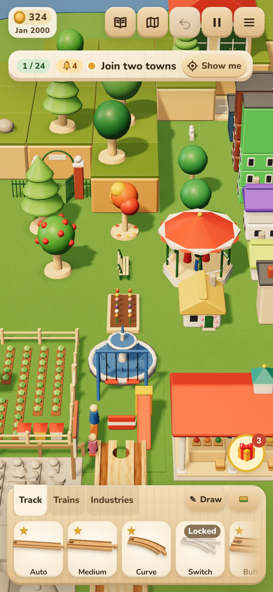

# Civic and leisure places, town treats and the paint shop

2026-11-04, designed on `claude/design-civic`, built on `claude/civic` (see "As built" at the end, for what changed).
Pictures (390×844) are in `docs/agents/shots/civic-*.jpg`, taken from the built game by `npm run e2e:civic`.

## Why

Today the Town life branch (8 rows) and the Leisure branch (14 rows) have no built node (tech-tree spec, gaps 1, 2 and
6). Two of them, Town hall and Park, are `key` tags a child sees from minute 0 that can never be learned. Coins pile up
after the first City (seed 2027: 1279 at minute 180 against a nice-to-have band of 150–600) with little to buy. The
town treats and paint shop plan (`plans/2026-10-24-town-treats-plan.md`, a57a272) is written but not built, and three of
its five treats (bandstand, fair, clock tower) are also rows here.

This spec gives each of those 22 rows a job, settles the overlap with treats, and says what each town level gives.

## Principles

- **A place does one thing, said in one line.** Four kinds of thing only (below). A child should be able to guess what
  a building does from its picture.
- **Coins, after the first City.** Every price leans on coins. Nothing new takes planks before the first City (tech
  tree §3). Town hall itself needs a City.
- **Research first.** While research is waiting for coins (`coinsShort(p) > 0`), Build and Buy are blocked and say why,
  as in the treats plan.
- **The map is the record.** A town has the places that stand in it. No new progress field. Prices and effects are
  read from the buildings, so undo and reload can't make them drift.
- **The balance player builds none of it**, so SUMMARY lines stay byte-identical. The payoff is for the real player,
  and it is bounded (smiles cap at −20%).

## 1. How you get a place

> **Decision 1: how a place gets into a town.**
>
> - **A (recommended): research, then Build on the town's card.** A blueprint unlocks the kind of place. Each town's
>   card then gets a **Places** row with a tile per kind: Build · N🪙. The place goes up on the next free lot, as a treat
>   does (`TownLife.addTreat`, one `nextLots` call). It's a choice: which town gets the cinema? It's also a coin sink
>   that grows with the map.
> - **B: they go up by themselves**, like the market. The first town to reach the level after the blueprint is learned
>   gets one. Simple, but there's no choice and no coin sink, and you can't aim one at the town you care about.
> - **C: drag them from the tray**, like an industry. This is the most toy-like, but town lots are made by growth, not
>   by hand. A dropped building would need the street and lot rules in the drop path (a big change), and it would clash
>   with town growth.

With A, the **Town hall** is the way in. Build a town hall in a town (60🪙) and its card shows **Places**. You can also
name the town (the row's old blurb: "Name your towns"). A town with no town hall shows one tile: "Build a town hall to
plan Larkfield's places". It's one more small step a child can understand ("the town needs a town hall first").

Places, like landmarks, can't be moved or picked up in Game mode, and growth never turns one into a shop (the treats
plan's rules for `Building.landmark`, reused). Places are not landmarks for `requires` and never count as the market.

## 2. What a place does: four kinds

> **Decision 2: the payoff.**
>
> - **A (recommended): smiles and visitors.** 😊 Smiles make a town grow sooner, 🎟️ visitors make coach trips to it
>   pay more, and a few places have one special thing each. Growth is the game's main loop, and visitors give the
>   passenger branch a reason to run coaches to a place.
> - **B: smiles only.** Every place is +1 😊. This is the simplest to read and build. But leisure and civic places feel
>   the same, and coaches gain nothing.
> - **C: looks and stickers only.** There's no balance risk, but it's what the brief asks us to move away from
>   ("more than decoration").

The four kinds (A):

| Kind | Rule | Card words |
|---|---|---|
| 😊 Smile | Each smile: the town needs **5% fewer goods** for each level (its `wants`, every good), **up to 4 smiles (−20%)**. Past four, a place still gives its other thing. | "2 smiles: Larkfield needs 10% fewer goods to grow." |
| 🎟️ Visitors | Riders who **get off** at this town pay **×1.5**, or ×2 in the place's busy season. Only the town's best place counts (no stacking). Seasons come from the calendar (`dateOf`): summer is Jun–Aug, winter is Nov–Feb. | "Visitors in winter: riders pay ×1.5" |
| 🚒 On the roads | A vehicle drives the town's streets (the town-cars code; ambient rules: it draws only when on screen and big enough). Looks only. | "A fire engine on the roads" |
| ⭐ Special | One rule of its own, listed per row. | its own line |

Smiles go into `townStatus(received, smiles)` as a factor on each level's `wants` (rounded up, never below 1). So a new
place can tip a town over into its next level at once. That's a nice moment: "Larkfield grew!" Places can't be
removed, so a town never shrinks.

## 3. The rows

Prices: research is the blueprint (once). Build is per town, unless marked **one per map**. "Needs" are other rows.
Rows whose needs aren't built yet (toys, trade, rack, clockmaker) are re-pointed or left for later, as noted.

### Town life (civic, 8)

| Row | Does | Research · needs | Build | Model |
|---|---|---|---|---|
| **Town hall** (key) | Opens **Places** on that town's card; rename the town | t2, 80🪙 · a **City** (was 20🪵+60🪙, a town) | 60🪙 | `bldg-town-hall` (exists) |
| **Fire station** | 😊 + 🚒 fire engine | t2, 100🪙 · town hall | 120🪙 | `bldg-fire-station` (exists); fire engine new (small) |
| **Police station** | 😊 + 🚒 police car | t2, 100🪙 · town hall | 120🪙 | `bldg-police-station` (exists); car: recolour a town car |
| **Hospital** | 😊 + 🚒 ambulance. City or bigger | t3, 150🪙 · college, town hall | 200🪙 | `bldg-hospital` (exists) |
| **Bank** | ⭐ Land and Lower hills cost **a quarter less** (map-wide). **One per map** | t3, 200🪙 · warehouses, town hall | 300🪙 | `bldg-market-hall` stand-in → new |
| **Museum** | 🎟️ all year + ⭐ its card shows your stickers and your first engine. **One per map** | t3, 200🪙 · university | 300🪙 | `bldg-library` stand-in → new |
| **Clock tower** | 😊 + a clock (the hands are live parts, as `ClockView`). Its old "leaves on the dot" timetable is for later | t3, 150🪙+10🔩 · town hall, foundry (was clockmaker, not built) | 200🪙 | new (the treats plan's `bldg-clock-tower`) |
| **Post office** | ⭐ Mail: bags wait at post-office towns for the others, ride in vans or coaches, and are paid like fares. **Later** (L: a new good with destinations) | as now | 120🪙 | `bldg-post-office` (exists) |

Not proposed: bank interest. Coins already pile up, and interest would add to that. Making land cheaper spends coins
instead.

### Leisure and sports (14)

| Row | Does | Research · needs | Build | Model |
|---|---|---|---|---|
| **Park and bandstand** (key) | 😊 (the cheapest smile) | t2, 4🪵+60🪙 · town hall (was carpentry) | 80🪙 | `scene-bandstand`, trees, bench, `scene-park-gate` (all exist) |
| **Sports field** | 😊 + 🎟️ spring and autumn | t2, 100🪙 · park | 120🪙 | new (flat: a pitch, two goals) |
| **Swimming baths** | 😊 + 🎟️ all year | t3, 150🪙 · park, electricity | 240🪙 | new |
| **Cinema** | 🎟️ winter | t3, 150🪙 · electricity | 200🪙 | new |
| **Theatre** | 🎟️ all year; the fare counts the trip as twice as far | t3, 180🪙 · college, stations | 260🪙 | new |
| **Beach and pier** | 🎟️ summer (×2) | t2, 120🪙 · stations · a town by water | 160🪙 | `scene-beach` + pier (new, small) |
| **Sailing club** | 🎟️ summer | t3, 150🪙 · harbours, park · a harbour town | 180🪙 | sailing boats (the harbour boat, small) |
| **Golf course** | 🎟️: riders who get off pay as first class (×2) | t3, 200🪙 · park, bank | 300🪙 | new (2×2) |
| **Funfair** | 🎟️ all year + ⭐ foods sold here pay ×1.25 | t3, 180🪙 · park, bakery (was toys, not built) | 240🪙 | the treats plan's `scene-fair` (carousel, pennants) |
| **Football stadium** | 🎟️ ×2 all year. City. **One per map** | t3, 300🪙+20🪨 · sports field | 500🪙 | new (2×2), floodlights |
| **Circus** | ⭐ a big top that moves to a new town every January (calendar), with 🎟️ there while it stays. A news line when it moves. **One per map** | t3, 200🪙 · funfair, goods engine | 300🪙 | big top new; `scene-tent` stand-in |
| **Racecourse** | 🎟️ + horse box wagon. **Later** (new car) | as now | 400🪙 | new |
| **Zoo and safari park** | 🎟️ + animal wagons. **Later** (needs trade) | as now | 400🪙 | new |
| **Ski resort** | 🎟️ winter, on the tallest hill. **Later** (needs rack) | as now | 400🪙 | new |

Research effects are left to the Learning branch on purpose (school, college, university). A place that sped up
research would compete with the college and pull on the stall band.

### Stickers (four new, looks only)

- **Happy town**: a town with 4 smiles.
- **Day out**: the first visitor's fare.
- **Civic pride**: a town hall, fire station, police station and hospital in one town.
- **Roll up!** (hidden; hint "Something big is coming to town"): the circus arrives in your town.

Each is a row in `STICKERS` with `deps: ["towns"]` (a version bumped when a place goes up) or `["counts"]` (a new
`visitorFares` count). They're checked in `checkGoals` only.

## 4. Treats and the paint shop: what each level gives

> **Decision 3: treats next to places.**
>
> - **A (recommended): treats stay looks-only and cheap, with the list changed so nothing doubles up.** The bandstand
>   moves into Park, the fair becomes Funfair, and the clock tower goes to Town life. In their place: a playground, a
>   flower clock and a street party. Places are for what a town *does*. Treats are for showing it off.
> - **B: drop treats.** Levels unlock places instead. That's one system fewer, but it loses the purchase a child makes
>   just because it's pretty, with no research needed.
> - **C: each treat gives a smile too.** That merges the two ideas, but treats then move balance, and the "just for
>   fun" row stops being just for fun.

With A, the ladder is below. **Treats** are per town: a town may buy the treats of its level and below. They open once
any town is a City (`TREATS_OPEN_LEVEL` 3, as the plan has it, since coins come then), and the price curve stays the
plan's: 100 + 50 × treats on the map. The **paint shop** is map-wide: it unlocks with the best town's level (from
the first Town, the plan's `PAINT_OPEN_LEVEL` 2). Both still need their research rows (C1 and C2 in the tech tree).

| Level | Free gift (goes up by itself) | Treat this town can buy | Paint shop (whole railway) |
|---|---|---|---|
| Hamlet | none | none | none |
| Village | none (today's growth) | 🛝 **Playground** (`scene-playground`, 1 square) | 🏷️ **Name plaques** on engines' cabs (free; names already exist) |
| Town | 🏪 Market (exists) | ⛲ **Fountain** (`scene-fountain`) | 🎨 **Paint shop opens**: red, green, royal, yellow, 60🪙 a coat |
| City | Town hall can be built (§1) | 🌼 **Flower clock** (`scene-clock-post` on a flower bed → new) | plum and black, 60🪙; a lining stripe, 80🪙 |
| City ★ | none | 🗽 **Engine statue** (of your first engine; new, Blender) | ✨ **Gold**, 400🪙 |
| City ★★ | 🎉 bunting over its streets (`scene-bunting`, free) | 🎆 **Street party**: stalls and long tables (2 squares) | 🌈 **Rainbow**, 600🪙 |

A town with every treat of its level gets the plan's rosette (`hasAllTreats`) and its goal. Changes to the plan,
a57a272:
- the `TREATS` table changes to the five above, with levels 1–5 (the plan had 2–4);
- `LIVERIES` gains `lining`, gold and `rainbow`; each has the level that unlocks it in place of the gold-only rule.

Everything else in the plan stands: the buy flow, placement, live parts and the save rules.

## 5. Balance

**Coins (the point of all this).** At 180 min the surplus is about 1,300 (seed 2027). One City-sized town with a
town hall, park, fire and police stations, hospital and one leisure place costs about 60+80+120+120+200+200 = **780🪙**.
The blueprints for all of that cost about 700 once. A second town costs 780 more. Treats at 100, 150, … 450 add
**about 2,200** for eight. So the sinks (about 4,000+ by the long game) are larger than the surplus. The player
chooses, and nothing piles up. Nothing is on sale before the first City, so the early coin famine (0–57 coins until
about 75 min) is untouched.

**Growth (smiles).** At most −20% of a level's wants. City → City ★ wants 33🪵 18 flour 15🪨 10🔩 6 furniture
(82 goods); four smiles save about 16 goods, a train and a half. Bounded, and felt. Smiles exist only after a City,
so the City-minute band (60–90) can't move. The town-gap band can only improve for a player who builds places.

**Visitors.** Fares are small (1 coin per 800 mm, at least 1). ×1.5 on alighting adds a few coins per coach, so
visitors are a reason to run coaches, not a money machine. Only the best place in a town counts.

**Bank.** A quarter off land (60 + 30n) and Lower hills (200–400). It spends coins faster rather than making more.

**How to check (each wave):**
- the nine-seed `BALANCE=1` table: SUMMARY lines must stay byte-identical (the balance player builds none of it);
- the goals play-through (no new goals; the treats goal is reached by Buy on the card, never by writing state);
- `npm run balance:sweep` at the release point.

A `BALANCE_CIVIC=1` harness mode (a named shortcut) would have the player build a town hall and park in its first City
and buy treats when idle. That gives a second table, to show the payoff (City ★ minute earlier) and coins at 180 still
inside the band.

## 6. Performance

- **Build or Buy is one tap:** one `nextLots(…, 1)` call, then that town's plots are drawn again (as the treats plan
  does). Nothing runs per frame or per pointer move.
- **Smiles and the visitor factor are derived on change.** They're cached per town by its buildings' version and read
  in `townStatus` and the fare. No per-frame work.
- **Vehicles and moving parts** follow `AmbientEye` and `AMBIENT_FRAME_MS`. An idle game with a park in view draws
  0 frames.
- **The Places and Treats rows** are drawn in the town card's `show`, keyed by `ledgerKey` plus the town's buildings
  version and coins-short state. They are never drawn per frame.
- **New materials:** none. Models use the catalogue's shared materials and the lacquer cache.

## 7. Build order (each wave lands alone)

1. **Places row and Town hall, Park, smiles.** `src/game/places.ts` (the table, `placeRow`, `townSmiles`), smiles in
   `townStatus`, the Places tiles, Build via `TownLife.addPlace`. Park and town hall stop being "soon". e2e: on a phone,
   learn town hall → build it in Larkfield → learn Park → build → the card says 1 smile and the town's wants drop.
   **Payoff asserted:** a delivery that was one short now grows the town.
2. **Fire station, police, hospital** (models exist) and the on-the-road vehicles.
3. **Treats and paint shop** (plan a57a272 with §4's changes).
4. **Visitors:** the fare hook in passengers (`alight` × the town's visitor factor), then sports field, swimming,
   cinema, theatre, beach, sailing, golf (stand-ins until art).
5. **One per map:** bank, museum, stadium, funfair, circus.
6. **Later:** post office mail, racecourse, zoo, ski resort, the clock tower's timetable.

### The models standing in towns already

`bldg-town-hall`, `bldg-fire-station`, `bldg-police-station` and `bldg-hospital` already go up as ordinary City
buildings (`props/storeys.ts`, levels 3–4).

> **Decision 4: those plain look-alikes.**
>
> - **A (recommended): they "open" for free.** When you learn Fire station, every town already showing a fire station
>   gets it as a place, with no coins and a toast: "Larkfield's fire station opens! +1 😊". Nothing is pulled down, and a
>   child is pleased. From then on, growth stops picking these four models for plain buildings.
> - **B: stop using them as plain buildings now.** Houses already standing keep their looks but do nothing. That's
>   honest, but a child sees a "fire station" that isn't one.

## Decisions (summary)

1. How a place gets into a town: **A, research then Build on the card** (B by itself, C from the tray).
2. What places do: **A, smiles plus visitors** (B smiles only, C looks only).
3. Treats next to places: **A, looks-only, list changed** (B drop treats, C treats give smiles).
4. Fire stations and other look-alikes already standing: **A, they open for free** (B stop using them).

The level ladder (§4) and the per-row table (§3) are proposals to approve or edit. They aren't open choices.

## As built (2026-11-04, `claude/civic`)

The user picked A for all four decisions and the level ladder as listed, with one change: **places cost coins and
goods**, the goods brought by train to the town (as a school's research goods are). Built:

- **`src/game/places.ts`**: the table (17 places and 5 treats), smiles (`townSmiles`, `SMILE_CUT` 5%, `MAX_SMILES` 4),
  visitors (`visitorFactor`, seasons by the calendar's month), the bank's `BANK_SHARE` and the funfair's `FUNFAIR_FOOD`.
  A place is a town `Building` whose `landmark` is its id; `townLandmarks` now returns only `LANDMARKS` ids, so a place
  is never a landmark for a blueprint's `requires`.
- **Goods by train.** `Economy.placePlans` (saved as `placePlans`, no version bump) holds each town's place under
  way and what it has had. At the town's station a unit the place still lacks goes into it first (`placeWants`, in
  `put`): not onto the pile, not toward growth, not paid. `TownLife.finishPlace` puts it up as the last unit lands;
  with no room it waits ("waiting for room") and is tried again as the town grows.
- **Smiles cut growth** in `townStatus(received, smiles)` (`wantsWith`: each level's wants × (1 − 5% × smiles), rounded
  up, never below one). Every caller goes through `statusOf(world, townId)`. A place going up can tip a town into its
  next level at once.
- **Visitors** in `fareFor` (×`visitorsAt`), counted as `counts.visitors` for the Day out sticker.
- **The card** (`src/game/place-row.ts` rules, `src/ui/places-row.ts` drawing): Places (a town hall first; then every
  learned place, and locked tiles for those that can be researched now), the place under way with its goods and Stop
  (coins back), and Treats once any town is a City (`treatPrice` 100 + 50 per treat on the map, bought outright).
  Keyed by `placeRowKey`, drawn only when it changes.
- **Prices** (Build): town hall 60🪙+12🪵; park 80🪙+8🪵; fire and police stations 120🪙+10🪵 6🪨; hospital 200🪙+10🪨 8🪵;
  bank 300🪙+10🪨 6🔩; museum 300🪙+12🪨 8🪵; clock tower 200🪙+8🪨 6🔩; sports field 120🪙+10🪵; swimming baths
  240🪙+10🪨 6🪵; cinema 200🪙+10🪵 6🪨; theatre 260🪙+12🪵 8🪨; beach 160🪙+12🪵; sailing club 180🪙+12🪵; golf
  300🪙+10🪵 6🪨; funfair 240🪙+12🪵 6🔩; stadium 500🪙+20🪨 6🔩. Only planks, stone and iron: no flowers or paint (they
  land with `claude/goods-chains`). Bricks could replace some stone once the brickworks is common.
- **Research rows** made real (no longer "soon"/"later"): Town hall (t2, 4🪵+80🪙, a City), Fire station, Police station,
  Hospital, Bank, Museum, Clock tower (needs Foundry: Clockmaker isn't built), Park (← Town hall), Beach, Sports field,
  Swimming baths, Cinema, Theatre, Funfair (← Park, Bakery: Toys isn't built), Golf, Stadium, Sailing club. Still later:
  Post office (mail is a new good), Circus, Racecourse, Zoo, Ski resort.
- **Look-alikes open free** (`TownLife.openFree`) as their blueprint is learned, with a News line; from then growth no
  longer builds plain ones (`retireStyles`, props/storeys.ts).
- **Stickers**: Happy town, Day out, Civic pride. Roll up! waits for the circus.
- **Paint shop** (`src/game/paint-shop.ts`, `src/ui/paint-sheet.ts`): 🎨 Paint on an engine's card from the first Town;
  red, green, royal and yellow (Town), plum and black (City), gold 400🪙 (City ★), Starlight 600🪙 (City ★★). A livery
  swaps the engine's modelled body and trim colours (`LIVERY_SLOTS`, `liveryRecolor`) through the lacquer cache; it's
  saved on the car (`livery`) and the car's model is built again once (`Sim.liveriesVersion`). Name plaques already
  existed (engine names), so the Village step gives nothing new.
- **Icons**: 16 new drawings in `src/icons` (smile, tree, ball, clapper, masks, beach, golf, carousel, stadium, slide,
  fountain, flower, ticket, picture, hospital, palette); others reuse existing glyphs (🔥 🌟 🪙 ⏱ 🌊 ⛵ 🚂 ✨). The font is
  23.4 kB of its 24 kB budget.

Not built (changed from the spec above): the lining stripe and Rainbow (each needs a modelled stripe: Starlight, a
two-colour scheme, stands in at City ★★); the free bunting at City ★★; the beach's "town by water" rule (the board can't
check a place yet); treats' moving parts and their own models (catalogue stand-ins, drawn a little smaller where a lot
is tight: `PLACE_MIN_FIT` 0.8); the circus moving each January.

Balance: the balance player builds and researches none of it. All nine seeds' SUMMARY and BANDS lines are
byte-identical to main (2027, 1, 2, 3, 4, 5, 6, 9, 10), every required band passes, and coins at 180 are 624–1297 (the
nice-to-have band is 150–600: this is the surplus the places are there to spend).

Checks: `src/game/places.test.ts` (17: the town hall by train, the park's payoff, smiles, visitors, Stop, no room,
one per map, save, treats, look-alikes), `src/game/paint-shop.test.ts`, and `npm run e2e:civic`.

## Built later (2026-11-05, `claude/leftovers-1`)

- **Lined** (City, 80🪙) and **Rainbow** (City ★★, 600🪙) in the paint shop, as §4 has them (Starlight stays). Each is a
  livery with a painted stripe (`Livery.stripe`): `addStripes` (render/train-models) puts a band along both sides of
  every body-coloured panel big enough for one, at its middle height and widest point: one gold line for Lined
  (the engine's own green and red), six bands for Rainbow (on cream). Built once with the car's model, one merged mesh
  per colour from the lacquer cache: nothing per frame. The paint sheet's swatches show the stripe.
- **City ★★'s bunting**, the free gift: a landmark (`bunting`, level 5) that goes up by itself on a lot of its own as a
  town reaches City ★★, the catalogue's `scene-bunting` (a `scene-flagpole` where the lot is one square: too short for its string).

