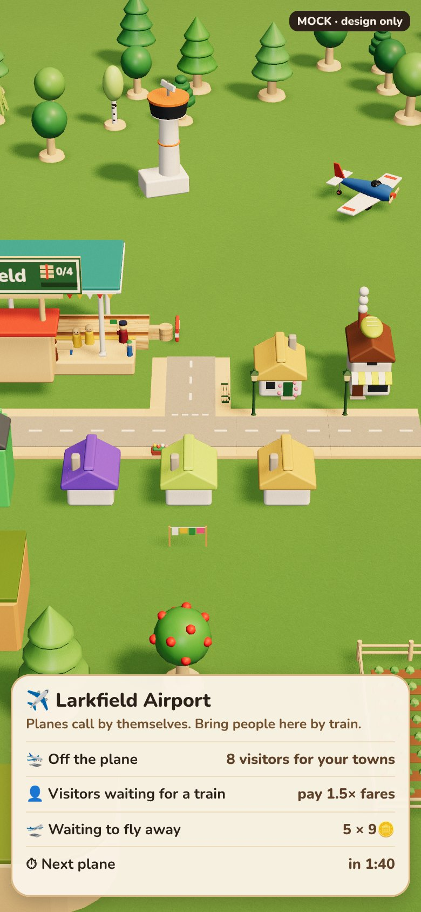
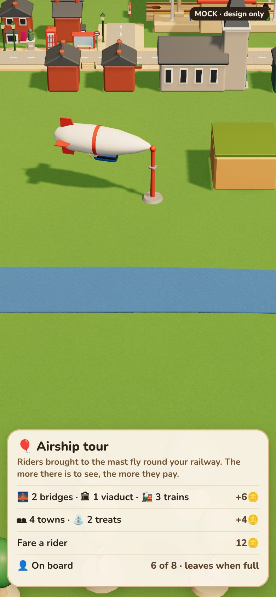
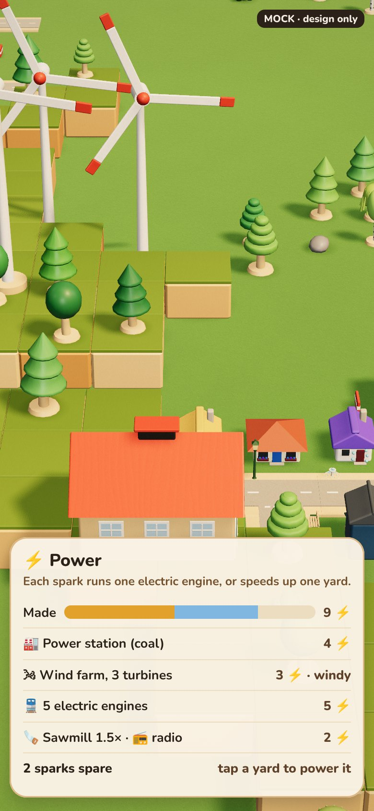
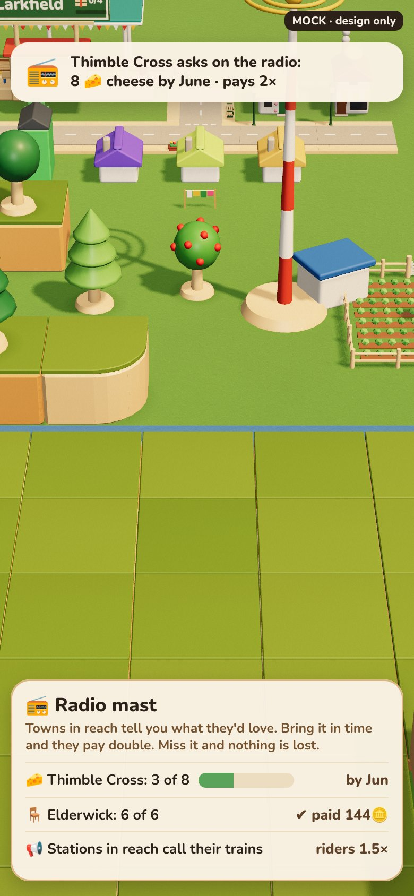
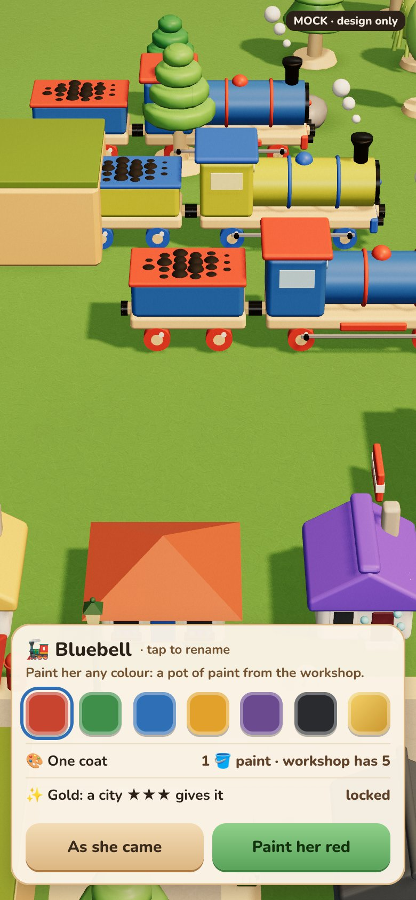
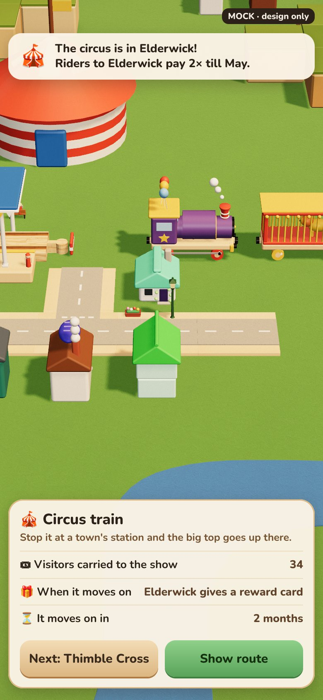
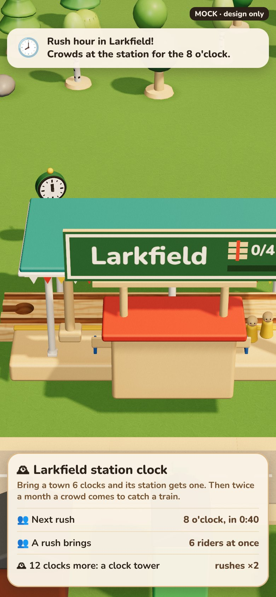

# Late game: air, power and radio, special trains (2026-11-04)

Status: design, for the user to choose from. Nothing here is built. Branch `claude/design-late-game`.

Three late-game areas whose rows are on the board today as "later" (`src/game/blueprints.ts`):

| Area | Rows today | Their blurb today |
|---|---|---|
| Air | `airport` (needs electricity, trade), `airship` (needs airport) | "Planes carry passengers between far cities; trains bring them to the terminal." / "A slow, grand airship over your railway." |
| Power and radio | `wind` (needs electricity), `radio` (needs electricity, telegraph) | "Windmills on the hills make power without coal." / "Stations announce the trains: more people travel." |
| Special trains | `paint-trains` (needs paint), `clockmaker` (needs smithy, college), `circus-train` (needs circus) | "Paint engines, wagons and stations in your own colours." / "Clocks for every station: trains keep a timetable." / "The circus tours your towns: crowds wherever it stops." |

For each, 2–3 options and a recommendation. Sizes are S (a day or so), M (a few days), L (a week or more), counting
models, tests, an e2e and the balance check, as in the tech-tree spec.

**Pictures** (mock, 390×844; the scene is the real game, the cards are drawn over it, and the turbine, mast and big top
are quick code models): `docs/agents/shots/late-*.jpg`, made by `node tools/shots/late-game.mjs`.

## What this builds on

- **Passengers** (`src/game/passengers.ts`): riders wait at towns' stations, get off at the next other town's station,
  and pay by distance. They have **no destination**. Riders carried unlock the passenger rows.
- **Harbours** (`src/game/harbours.ts`): a depot whose boats call by themselves every 150 s, take what is on the
  quay, and pay half a town's price. Nothing is steered. This is the pattern for planes.
- **Power** (`economy.ts`, `engines.ts`): a power station burns 1 coal a minute. While **any** has coal, every electric
  engine runs (`powered(world)`); with none, they stop ("No power"). That is power's only use today.
- **Depots have a `rate`** (`DepotState.rate`, `cycleTicks`): a yard can work faster without new machinery.
- **The calendar** (`calendar.ts`): a month every 120 s of play. Good for "by June" and "twice a month".
- **Growth cards** (`rewards.ts`, `offerOnGrowth`): a town offers a reward card when it grows.
- **Gifts on learning** (`learnGift`): learning a row can put things in the tray.
- **Planned, not built:** the paint shop and town treats (`plans/2026-10-24-town-treats-plan.md`), the Dye works
  (`paint`, "next"), Toys ("next"), Telegraph, Imports and exports (`trade`), Town hall ("soon").

The direction spec's rules hold: cozy (nothing fails, expires or wears out), every unlock shows something new and
ideally changes play, specialise without locking out.

## 1. Air

 

The test for anything that flies: **it must make the railway busier, not replace it.** A plane that carries what a
train would is a worse game.

### Airport

**A1. A gateway, like a harbour for people (recommended).** An airport is a depot by a town. Planes call by
themselves every few minutes and fly in and out in a straight line from the map's edge.
- **Out:** riders a train brings **to** the airport fly away, paying a far fare (as if they'd ridden twice the map:
  about 9🪙 each, more than any train fare).
- **In:** each plane leaves visitors at the airport. They wait like any town's riders, and a train takes them to a
  town, where they pay 1.5× the fare.
- **The tie to trains:** the airport does nothing without trains both ways. A line from your cities to the airport
  becomes the busiest line on the map.
- **Build: M.** A depot role (the harbour's pattern: a visitor clock, a quay pile becomes waiting riders); a plane
  view (one instanced plane, a straight path, ambient rules); the card. The catalogue has a control tower and a
  propeller plane. No routing change: visitors are ordinary riders with a fare factor.

**A2. Your own air link.** Two airports, and a plane flies riders between them, across water or hills.
- Fun to watch, but it does the trains' job. The railway gets quieter.
- **Build: M–L** (two-airport pairing, a link UI, plane capacity).

**A3. Air freight.** Planes take goods off a cargo apron at full pay.
- It overlaps the harbour (which pays half), and makes the harbour pointless.
- **Build: M.**

### Airship

**B1. A sightseeing tour (recommended).** A mast stands beside a station. Riders brought to it board the airship,
which leaves when it is full and flies a slow loop over your railway. The fare grows with **what there is to see**
inside the loop: bridges, viaducts, towns, treats, trains running.
- **The tie to trains:** the tour pays for a beautiful, busy railway, and riders get there by train.
- **Build: S–M.** The airship model and mast exist (`veh-airship`). The loop is a circle, and its fare is counted
  once, at take-off, from things the map already lists. It is ambient motion: drawn only while visible and big
  enough (AGENTS.md).

**B2. A sky crane for the rocket.** The airship lifts the rocket's last big part to the launch pad.
- A grand moment, but the rocket isn't designed yet. **Keep it as a hook for the rocket spec.**

**B3. Scenery only.** It floats over the map and does nothing. **Build: S.** It doesn't pass "unlock changes play".

### Gating

`airport` needs `trade`, which isn't built. **Recommend:** the airport needs `electricity` and `harbours`, and 400
riders carried (the passenger line's kind of gate). The airship needs the airport.

## 2. Power and radio

 

Today power is a single on/off switch for electric engines. A wind farm would only mean "no coal needed", which
matters only to a player with electric engines. So power needs a real use first.

### Power

**W1. Sparks: power you share out (recommended).** Power is counted in sparks ⚡.
- **Making sparks:** a power station makes 4 while it has coal. Each wind turbine makes 1, always. Turbines go on
  hilltops only, and a farm holds up to 6 (geography nudges).
- **Using sparks:**
  - each electric engine takes 1;
  - a **powered yard** takes 1 and works 1.5× as fast (`DepotState.rate`): you tap a sawmill, foundry or factory's
    card to power it;
  - a radio mast takes 1;
  - later, the cinema and swimming baths.
- **Short of sparks (cozy):** an electric engine without a spark runs at steam speed instead of stopping. Today it
  stops. Yards are powered in the order you tapped them.
- **The tie to trains:** coal power needs a coal train. Wind needs none, but only on hills. Both are worth having,
  and the power card shows the sum.
- **Build: M.** A spark count, worked out on events (a depot added or removed, a coal pile reaching or leaving 0, an
  engine placed or put away, a yard tapped), never per frame. `topSpeed` reads a cached flag. Turbines are a new
  model (a quick one is in the picture). Blades turn only when visible.

**W2. Wind is just coal-free power.** A wind farm keeps `powered()` true without coal.
- It's honest and tiny, but it only matters with electric engines, and gives nothing to trains.
- **Build: S.**

**W3. Power lines.** You draw wires from power to yards and towns, and what is wired works faster or grows.
- It's the most "real", but it means a new drawing tool on a phone, reach rules, and a map-wide mesh.
- **Build: L.** Not worth it here.

### Radio

**R1. Radio asks (recommended).** A mast covers the towns within reach (about 12 squares). Now and then (every few
game months), a town in reach asks for something it already buys: "Thimble Cross asks: 8 cheese by June". Units
delivered by then pay 2×.
- **Cozy:** if you miss it, nothing is lost and another ask comes later.
- **Stations announce:** stations in reach get riders 1.5× as often.
- **The tie to trains:** a reason to send a particular train somewhere this month. The late game has no
  "what next?" today, and this gives one.
- **Build: M.** Asks are drawn on the month tick (the calendar), not per frame, from goods the town's station
  has had. One line on the town card, a toast, and a Journal entry. Saved as a few optional fields.

**R2. Announcements only.** Riders 1.5× in reach, as the row says today.
- **Build: S.** It's real, but it's a number you never see.

**R3. Radio dispatch.** You tap any train and send it to a stop.
- It overlaps the Telegraph's "call home", and is a routing change.
- **Build: L.**

### Gating

The radio needs `telegraph`, which isn't built. **Recommend:** it needs `electricity` only, plus 1 spark to run. The
wind farm stays after `electricity`.

## 3. Special trains: paint, clockmaker, circus

  

**One rule for all three (recommended): special trains are earned, never bought.** Learning the row gives the
thing once, as a gift in the tray (`learnGift`), with a sticker. There is one circus train, not a shop of them.

### Paint your trains

**P1. A coin paint shop (the plan already written).** A paint pot on the engine's card: 7 colours at 60🪙 each, and
gold at a city ★★★. Plus a name board.
- **Build: S–M**, and the plan is ready (`plans/2026-10-24-town-treats-plan.md`, part C). It's a coin sink.

**P2. Paint costs paint (recommended, after P1).** The same pot and sheet, but a coat costs 1 🪣 paint from the
workshop, as a car carrier costs iron there. Paint comes from the Dye works chain (flowers, then dye, then paint).
- Coins only until the Dye works is built: ship P1, then switch the price.
- **What it does in play:**
  - an engine's paint is its line's colour on the route map and the lines view, so many lines are easy to tell apart;
  - otherwise it is looks only. Paint never changes pay.
- **Build: S** on top of P1, once the Dye works exists.

**P3. Free paint once learned.** **Build: S**, but it ties to nothing.

### Clockmaker

**C1. Timetables.** Routed trains leave each stop "on the dot", evenly spaced.
- It cures bunching, but it touches routing, holds and every train invariant.
- **Build: L**, with a real risk of stalls. Not now.

**C2. Clocks are goods, and clocks bring rush hours (recommended).** A Clockmaker yard turns iron and planks into
clocks, a full-pay luxury.
- **The station clock:** a town that has had 6 clocks gets a station clock (the catalogue's `bldg-station-clock`, its
  hands already drawn by `ClockView`).
- **Rush hour:** from then on, twice a game month, a crowd of 6 riders turns up at once for the next train.
- **The clock tower:** 12 more clocks give a town treat that doubles the rushes.
- **The tie to trains:** passenger lines worth timing, and a new chain off the foundry.
- **Build: M.** One recipe and a yard model; a rush is a burst in `peopleArrive` on the month tick; a toast.

**C3. Clocks as scenery only.** Lineside clocks already exist (Scenery kit). Nothing to build, and nothing gained.

### Circus train

**K1. A touring circus you route (recommended).** Learning Circus gives the circus train: the catalogue's circus engine,
two cage wagons and a coach. Route it like any train.
- **The big top:** when it stops at a town's station, the big top goes up on a free lot there (the lot logic growth
  uses) for 3 game months.
- **While it stands:** riders carried to that town pay 2×, and its station gets riders twice as often.
- **When it moves on:** the town offers a reward card (`offerOnGrowth`'s kind), and the big top comes down.
- **Next:** the card suggests the town the circus hasn't visited for longest. A sticker for visiting every town.
- **Build: M–L.** Two models exist (`train-circus-engine`, `train-circus-cage`). The big top is new, and putting it up
  and taking it down needs lot logic that doesn't exist yet (treats are also unbuilt). There's a "stopped at a
  town" event, a fare factor, a card, and save fields.

**K2. The circus visits by itself.** It arrives from the map's edge.
- It needs track to the edge, so it's hard to guarantee.
- **Build: L.**

**K3. A looks-only special train.** **Build: S.** It doesn't pass "unlock changes play".

### Gating

- `paint-trains` stays after the Dye works.
- `clockmaker` stays after smithy and college (both built).
- `circus` needs Toys (not built). If Toys slips, gate it on `goods-engine` and two towns at Town.

## Build order (if all the recommendations are taken)

1. **Sparks (W1) and the wind farm.** This is the base for the radio, and fixes "No power" stopping trains. M.
2. **Radio asks (R1).** M.
3. **The paint shop (P1)**, from its plan. S–M.
4. **Clockmaker and rush hours (C2).** M.
5. **The airport (A1)**, then the **airship tour (B1).** M, then S–M.
6. **The circus train (K1)**, after town treats (it shares the lot logic). M–L.
7. **Paint costs paint (P2)**, when the Dye works lands. S.

Each step ships on its own:
- `npm test`, typecheck and build pass;
- the play-through reaches the new goal by the player's path;
- an e2e asserts the payoff (a plane pays, a powered yard makes more, an ask pays 2×, a rush fills a train, a circus
  town pays 2×);
- `perf:check` holds: 0 idle frames with planes, turbines or an airship in view and paused;
- `balance:sweep` is run on the steps that pay coins (2, 4, 5, 6).

New save fields are optional, so there's no `SAVE_VERSION` bump.

## Decisions for the user

1. **Airport:** A1 gateway (rec.) · A2 own air link · A3 air freight.
2. **Airship:** B1 sightseeing tour (rec.) · B2 rocket sky crane (later) · B3 scenery.
3. **Power:** W1 sparks shared out (rec.) · W2 coal-free switch · W3 power lines.
4. **Radio:** R1 asks plus announcements (rec.) · R2 announcements only · R3 dispatch.
5. **Paint:** P1 now, then P2 paint costs paint (rec.) · P1 only · P3 free.
6. **Clockmaker:** C2 clocks and rush hours (rec.) · C1 timetables · C3 scenery.
7. **Circus:** K1 touring circus you route (rec.) · K2 visits by itself · K3 looks only.
8. **Special trains are gifts, one each, never bought** (rec.): yes or no.
9. **Gates:** re-point the airport (to harbours plus 400 riders) and the radio (to electricity), since `trade` and
   `telegraph` aren't built (rec.), or build those first.
