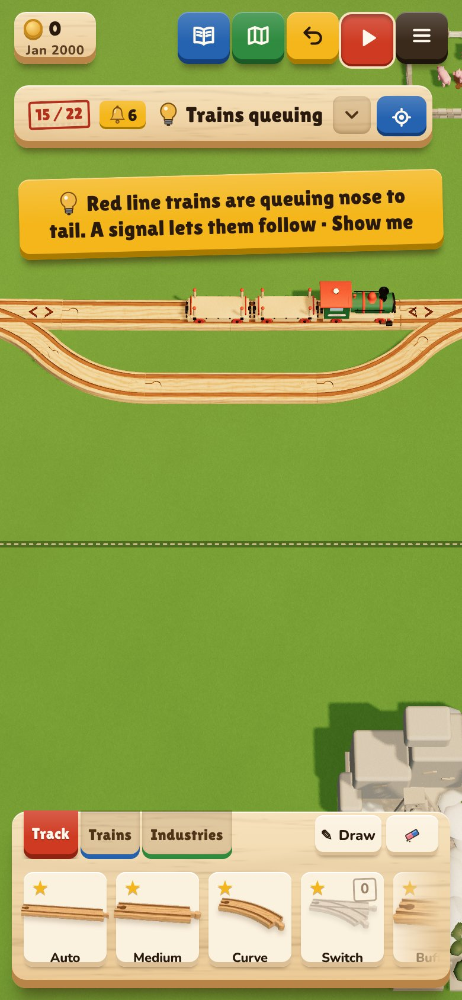
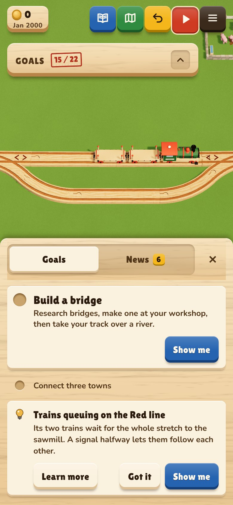
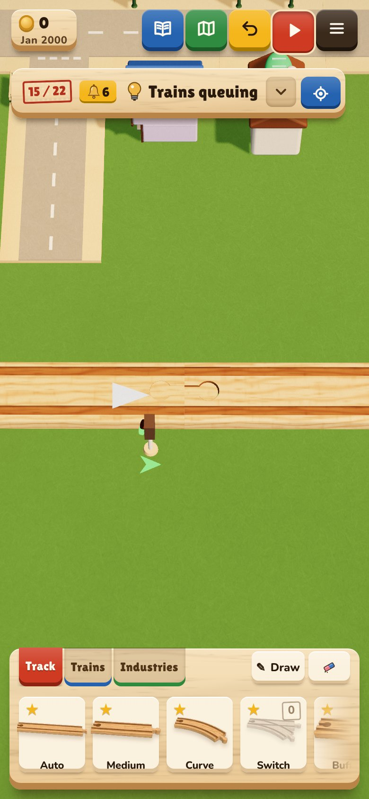
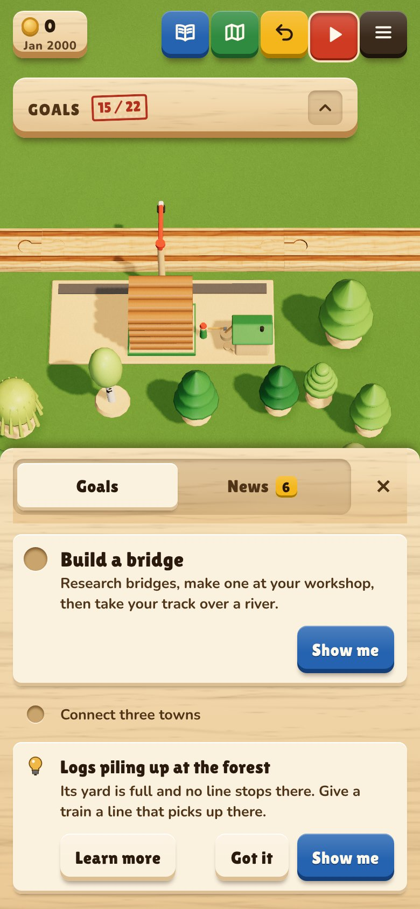

# Situation help: a tip when the player is stuck

Status: proposal, for approval (nothing built). 2026-11-18.

The user's idea: "context-specific help that pops up when people get into situations like jams… if we can see that
they might need more signals and are in a jam we can pop up some signals help (maybe one time, or let them dismiss).
Could be other situations we could detect and offer help too."

This is no new UI layer. It is the 💡 feature tip row (src/game/feature-tips.ts) given a second kind of tip: one that
appears because of what is happening on the map, not because a blueprint was just learned. The parts are all there
already:

| Part | Where it is today | What situation help adds |
| --- | --- | --- |
| 💡 row under the goals: Show me, Got it; folded, the chip says `💡 <title>` | `TipTracker`, `tipRowHtml` (goals-panel.ts), `checkTips` (main.ts) | a **Learn more** chip, and a title without "New:" |
| Toast once, a tap is Show me | `checkTips(announce)` for tips with no blueprint | the same |
| "Learn more" sheets | `explainers.ts`, `explainer-keys.ts` (Signals, Routes) | one more sheet, Passing loops (step 2) |
| What is wrong, and why | the engine card's why-texts (engine-status.ts: `stuck`, `needs-loop`, `single-track`, `loop-signal`, `Can't reach …`) | none: the detectors read the same states |
| Spotting the situation | `Stalls.onStuck` (stalls.ts: rings, too-many, parked, signals, loop-signal; `STUCK_S` 5 s, `STARVED_S` 120 s), `Sections.followSpot` (`FOLLOW_HINT_S` 20 s), `Sections.singleTrack`, `Economy.shortSkipOf`, `notLoadingAt`, `waitingToFill` | a tracker that reads them on its own timer |

Three one-off tips are already situation help, said in their own ways. This spec brings them under one roof:

- `FOLLOW_TIP` ("Trains on this line wait for the whole stretch. A signal here lets them follow · Show me where"):
  a toast, once **per device**, `woodrail.followTip` (main.ts `lookForFollowers`).
- `headOnTip` ("Trains met head on. A passing loop lets trains pass"): a toast on the first `in-way` stall, once per
  device, `woodrail.loopTip`, with no Show me.
- `fullLineToast`, the Leave now tip and the Ring lines tip (the last two are already `FeatureTip`s with no blueprint).

## 1. Detectors

### What players hit most

There is no `ADMIN_KEY` in this session, so the play stats (`npm run stats`, Analytics Engine) and the snapshots
(`npm run snapshots`) could not be read. The stats hold only `start`, `goal`, `end` and `error`: they would show
where players stop in the goals, not why. The ranking below comes from what could be read:

- **The feedback reports** filed as GitHub issues (the "Report a bug or give feedback" form, 7 player reports, all
  from the owner's own play): 4 of the 7 are trains that stopped and the player couldn't tell why:
  - #29, "blocked by a train all the way on the other side of the map" (single track, `STARVED_S`);
  - #31, "the signal ahead of it is green" (a signal inside a passing loop, `loop-signal`);
  - #32, "added a signal but all trains are still stuck" (a ring through signals);
  - #44, "my trains all suddenly stopped moving" after a track edit (Sandbox).
  - A fifth, #45, followed #44 a few minutes later: "apparently I had paused the game. oops."
  - Of the other two, #26 is goods not unloading (the card's not-loading text now says why) and #27 is trees.
- **The QA playtests**: on 2026-11-04 two trains on the starter line both waited ("this line has a train too many").
  The 2026-11-09 audit's `fuzz:long` had 53 seeds stall, most of them `too-many`.
- **The code**: the why-texts with the most branches (stuck, needs-loop, full-wait) are those for jams.

So jams come first by a wide margin, and "it's paused" is the cheapest real one after them. The rest are ranked by how
often they can occur in a normal game, and they are marked *unproven*: to be checked against the `help` stats event
(step 7) before they're built.

### The detectors, ranked

Each detector is a function from what the sim already knows to `null` or one situation: its kind, a key (a line, a
depot, a train), where it is, and the words. **Hold** is how long it must be true before it is said. All times are
game seconds.

Jams have different fixes, and the stall classifier already tells them apart, so "a jam" is five detectors, one for
each cause. A signal does not help two trains nose to nose, so a tip that says "add a signal" there is wrong.

| # | Kind (id) | Trigger | False-positive guard | Tip (title · line) | Show me | Learn more |
| --- | --- | --- | --- | --- | --- | --- |
| 1 | **Queuing, a signal helps** (`jam-follow`) | `Sections.followSpot() !== -1`: a line's train has stood ≥ `FOLLOW_HINT_S` (20 s) at its slot's end, waiting for a train of its own line going the same way through a stretch long enough to split | followSpot's own checks (same line, same direction, not one coming back, the stretch splits with room for the longest train); Signals learned (Game mode); the line has ≥ 2 trains; the spot found twice running, 5 s apart | **Trains queuing on the Red line** · "Each train waits until the one ahead reaches the sawmill. A signal halfway lets the next one start sooner." | the spot and the waiting train framed together, ghost signal and block tint, the Signals shelf open with the Signal picked | Signals → "Trains wait for the line ahead" |
| 2 | **Too many for the signals** (`jam-signals`) | `onStuck` with `why: "signals"`, not `headOn` | a stall is said only after `STUCK_S`; held 15 s more (the player may be fixing it); Signals learned | **Trains stuck at signals** · "There are more trains than gaps between signals. Add a signal, or take a train off." | the trains in the ring, framed | Signals → "Trains wait for the line ahead" |
| 3 | **A signal inside a loop** (`jam-loop-signal`, #31) | `onStuck` with `why: "loop-signal"` | as #2 | **A signal is in the way** · "A train waits at a signal inside the passing loop, its tail over the points. Move the signal to the loop's end." | that signal, its card opened | Signals → "Two at a passing place" |
| 4 | **No passing place** (`jam-loop`) | `onStuck` `in-way` with `loop: true`, `too-many`, `signals` with `headOn.loop`; or a train in `stuck: single-track` (`STARVED_S`, #29) | as #2; Switches learned (else the text says to learn them, as `headOnTip` does); not while a train is derailed or held by hand | **Trains can't pass** · "Two trains meet on single track. A passing loop in the middle lets them pass." | the stretch (`Sections.singleTrack(engine).pieces`) framed, its middle marked | Passing loops (new, step 2) |
| 5 | **Paused** (`paused`, #45) | the game is paused and the player taps an engine, opens a train's card, or sets one going; or it has been paused for 2 wall-clock minutes while they lay track | never in the first 10 s after they pressed Pause themselves; only once a session even if dismissed (it's cheap to hit again) | **The game is paused** · "Trains stand still while it's paused. Tap ▶ to run them." | the ▶ chip pulsed (no camera move) | none |
| 6 | **Can't reach a stop** (`unreachable`) | `Economy.shortSkipOf(engine)` (a line end too short to turn in), or `Sections.unreachable(engine)` (a full line), for 30 s | the card already says it, so the tip is only for a train **not looked at**: no card of it open in the last minute | **The Blue line skips Elder** · "A line end on the way is too short for its train to turn. Lengthen it, or take a car off." | the line end (`short.at`) | Routes → "Plan a route" |
| 7 | **Goods piling, nobody fetches them** (`pile-unserved`) | a depot that gives goods has a full pile, no line stops there to pick up (`pick` or `auto`), and no train has been worked there for 3 game min | only for depots the player placed or connected (track joined); not in the first 5 min after it was placed; one depot at a time, the fullest | **Logs piling up at the forest** · "No train collects its logs. Add the forest to a line." | the depot's card | Routes → "Plan a route" |
| 8 | **A queue at one track** (`yard-queue`) | two or more trains standing ≥ 60 s for the same depot while one is worked there (`servingDepot` of the first; the others waiting with `by` = that train), and the depot has one track | Second track learned (`TRACKS_TECH`); the depot has room for another (`trackCount` below the max); it folds into the Sidings feature tip: if that tip hasn't been used, this one is it, and showing it uses up the Sidings tip | **A queue at the sawmill** · "Trains wait their turn under one crane. A second track lets the next one stand ready." | the depot's card, Second track | none (step 6 may add a Sidings sheet) |
| 9 | **Too long for the yard** (`too-long`) | a train worked with its tail on points (`standsOnPoints`) twice in 5 min | not for a train on no line | **Too long for the mill's yard** · "Its tail sits on the points while it loads, holding up other trains. Take a car off, or add a second track." | the train | none |
| 10 | **A town short of something** (`town-short`, *unproven*) | `TownLife.lacks(town, kind) > 0` for 10 game min for a good that blocks its next growth, and a maker of that good is on the map | not if a line already drops that good at that town; one town at a time | **Larkfield wants bread** · "The bakery has it. Add Larkfield to a line that carries bread." | the town card | Routes |
| 11 | **An engine standing idle** (`idle-train`, *unproven*) | an engine with its lever off and no line for 5 game min, while some line exists | never for a train parked in a siding next to a yard (it's being kept); not while there are no lines (the goals teach them) | **Bramble is standing idle** · "Give it a line from its card, and it runs by itself." | the engine's card | Routes |

Looked at and left out:

- **Trains bunching on a line**: auto-spacing already holds them apart (`spacingWait`, the `spacing` state). On the
  staged map for these pictures the line's trains spaced themselves; there's nothing left to tell.
- **Off the rails**, **no power**, **too heavy**, **the rack**: the card already says the fix in the moment, and the
  breakdown crane drives out by itself. They're rare and they explain themselves.
- **Leave now** and **Ring lines**: already situation tips (feature tips with no blueprint). They move into the new
  tracker unchanged (step 1), so all tips share one slot and one off switch.

## 2. Behaviour

**One slot.** The 💡 row shows one tip. A situation tip that is live outranks a feature tip, because it's about now.
The feature tip waits and comes back when the situation clears.

**When a tip may show.** All of these must hold:

- Game mode. Sandbox has no goals panel; there a situation tip is a toast only, with the same once-per-kind rule (step 5).
- Not during the tutorial: no tip while the current goal comes before `FIRST_OPEN_GOAL` ("build-bridge"), while the
  controls coach shows, or in the first 2 minutes of a game.
- Nothing else is talking: no sheet or card open (it waits for them to close), no toast in the last 8 s, and no other
  tip shown in the last 2 game minutes.
- Its kind isn't done or snoozed for this game, and situation help isn't switched off.

**How it shows.** The first time a kind shows in a game, a toast says it once, and a tap on it is Show where:

- the toast is one short line with a printed "Show where ›", 8 s, plain (not a celebration);
- the folded chip reads `💡 <short title>` only while the toast is up, then goes back to the goal, with a small 💡
  badge beside the 🔔;
- the 💡 row waits under the goals, stamped **Tip**, with a Learn more link under its line, then Got it and **Show
  where** (a printed chip: the goal keeps the one painted Show me).

There is no modal and no sound, and the camera doesn't move by itself.

**How it goes.**

| What happens | The tip | Its kind |
| --- | --- | --- |
| The player taps **Got it** (titled "Hide tips like this") | goes now | done for this game; ☰ Tips lists it, with Show again |
| The situation clears after the player changed track or signals, or a line's trains, within 60 s of looking at it (Show me, Learn more, or the card) | goes, with a quiet "✓ They follow now" toast (one per kind) | done: it worked |
| The situation clears by itself | goes quietly | snoozed for 10 game minutes, then may come back (the toast isn't repeated) |
| Still there after 5 game minutes, no taps | stays | after a third showing in a game it stops coming back: done |
| ☰ **Tips: off** | all tips go, feature tips too | none show until it's on again |

**Saved.** Done, snoozed-until and toasted are kept per game, in the game's session slot (beside `journal`), so a
second game (Your games) starts fresh. The feature tips' `woodrail.game.tips.v1` is one per device today and would
move into the slot too. The ☰ switch is one per device (`prefs.ts`, like Chain hints). On load the old
`woodrail.followTip` and `woodrail.loopTip` mark `jam-follow` and `jam-loop` done in the open game, so a player
already told isn't told again.

**Cost.** None of it runs per frame.

- The tracker runs from `checkGoals`, which already runs about once a game second and after every track change, and
  doesn't run while paused. It does nothing in the tutorial or with tips off.
- Each detector has its own interval and reads data the sim keeps up anyway:
  - #2–4 are event-driven: `Stalls.onStuck` already fires, and the tracker keeps the latest stall per kind. A check
    is a map lookup.
  - #1 is `followSpot()` every 5 game s; it already runs once a second today, so this is 5× less. Its cost is
    O(waiting trains) with a short walk ahead.
  - #6, #8 and #9 are O(trains) every 5 s, and only for trains standing.
  - #7 is O(depots + line stops) every 10 s.
  - #10 and #11 are O(towns × wants) and O(engines) every 30 s.
  - #5 is event-driven: a tap or a card while paused, plus one wall-clock timer while paused that is cancelled on
    unpause.
- The DOM is written only when the tip shown changes (`GoalsPanel.setTip`'s `shownKey`).
- Measure: `npm run bench:tick` on every bug map before and after, with the tracker run as main runs it. The target
  is under 1 % of a tick, and the commit states the numbers. `e2e:situation-help` checks 0 idle frames with a tip
  showing, folded or open.

**Words.** Each tip says the problem in the player's words (named line, named place), then one fix, in a single
sentence each, with no ids and no "section" or "slot". The titles fit the folded chip at 360 px: the chip uses a
short title ("Trains queuing"), the row the long one.

## 3. Pictures

Made over the running game by `node tools/shots/situation-help/stage.mjs`. It sets up Game mode on a 390×844 phone
with map code `4242-flat-water-none-nocoast`, the follow hint's own layout (`⊐ forest ══ loop ══ × 8 ══ sawmill ⊏`,
signal-slots.test.ts), and one line with two timber trains. The game runs until one train stands waiting for the
other, then pauses. The tip row is mock HTML in the real panel's classes; the toast and Show me are the game's own
`hud.toast` and `showSignalSpot`.

Setup shortcuts, for the pictures only: the tutorial goals are marked done, and Switches, Routes and Signals are
learned.

| | |
| --- | --- |
|  | **1. First seen.** One toast, folded chip "💡 Trains queuing". The waiting train in the loop below it. |
|  | **2. The row** under the next goal: Learn more · Got it · Show me. The critique below changes this: Learn more becomes a link, Show me becomes a printed "Show where", and the row gets a "Tip" stamp. |
|  | **3. Show me, as `showSignalSpot` frames it today**: 900 mm from a ghost post on bare track. Too close: the reason (the waiting train) is out of view. Step 1 frames the spot and the waiting train together (`frameAlong` over both, as goals do). |
|  | **4. Another kind** (piling, #7), for the row's layout only. In this staged map the forest *is* on the line. |

### Critique (/impeccable critique)

Run as two isolated passes: a design review of the four pictures, and the detector with measurements on the row
rebuilt from the game's own CSS.

**Score: 25/40** on Nielsen's ten heuristics.

| Heuristic | Score | Heuristic | Score |
| --- | --- | --- | --- |
| Status | 3 | Recognition | 2 |
| Real world | 3 | Flexibility | 3 |
| Control | 2 | Minimal | 3 |
| Consistency | 2 | Recovery | 2 |
| Error prevention | 2 | Help | 3 |

**What the review found.**

- **It fits the game.** The pictures use the game's own parts: the lacquered yellow toast, a maple tile, printed
  chips. There is little new UI. Naming the line ("on the Red line") makes the tip feel specific to this railway, not
  generic advice.
- **Weakest part: Show me.** It drops the player 900 mm from bare track. The trains are out of view, the line has no
  colour, and the right tool isn't to hand.

**What the measurements found.**

- The detector reported 5 warnings, all false positives. They are the game's own look: the cut-wood inset edges read
  as "side tabs", the tile on a board as "nested cards", the toast's 1.2 display leading, and its clicked-into-place
  overshoot.
- Every button is 44 px tall.
- Contrast is 9.2 to 15:1.
- The legibility of the toast over the 3D scene was not measured.

**Changes taken into this spec** (they replace what the pictures show):

1. **Show me finishes the job.**
   - It frames the waiting trains and the spot together, with the ghost signal big enough to read as a signal.
   - It opens the Signals shelf with the Signal picked, so one drag places it.
   - A one-line caption says what to do: "Put a signal here".
2. **One painted button per sheet.** The goal keeps the blue Show me. The tip's button is a printed chip that says
   what it does: **Show where**.
3. **The folded chip keeps the goal.** A tip shows as a small 💡 badge beside the 🔔. The chip reads the tip only
   while its toast is up, then goes back to the goal.
4. **A stamp tells the two kinds apart.** A blueprint's tip keeps "New: …". A situation tip is stamped **Tip**.
5. **Learn more becomes a text link** under the line, not a chip. The row then has two buttons, Got it and Show
   where, with no gap where a button seems to be missing.
6. **Got it says what it does.** Its title is "Hide tips like this". ☰ **Tips** lists the hidden kinds, each with
   **Show again**, so a child's tap to clear the row isn't for ever.
7. **Plainer words** (the table above is updated):
   - Queuing: "Each train waits until the one ahead reaches the sawmill. A signal halfway lets the next one start
     sooner."
   - Piling: "No train collects its logs. Add the forest to a line."
   - The toast is one short line ("Red line trains are stuck in a queue") with a printed "Show where ›".

**Left open, for the user:**

- *If the game knows where the signal goes, should Show where offer "Place a signal here" (one tap, with undo)
  instead of teaching?* It would be quicker, but the player would learn less, and Signals are something the player
  makes at the workshop. A possible middle way: the ghost signal is tappable, and a tap places it.
- *Is a jam really a temporary goal?* It could appear in the goals list with a tick and a payoff when the trains
  flow again. This spec keeps it as a tip, with the "✓ They follow now" toast as the payoff.

## 4. Plan

Each step can land on its own, with its tests, `/check` at its tier, and an `e2e:affected` rule for new modules.

1. **Jam → signals, end to end.**
   - `src/game/situation-tips.ts`: `Situation`, `SituationTracker` (done, snoozed, toasted, shown count; `update(w,
     ctx)` → the one to show), and detector #1 (`jam-follow`, moved out of main's `lookForFollowers`). Leave now and
     Ring lines move in as detectors.
   - The row: the existing tip row with a **Tip** stamp, a Learn more link (opens the Signals sheet at its first
     section), and a printed **Show where** chip.
   - The chip shows the 💡 badge, and the tip's title only while its toast is up.
   - Show where frames the waiting train and the spot together (`showSignalSpot` with a frame over both), opens the
     Signals shelf with the Signal picked, and captions it "Put a signal here".
   - Got it (hide this kind; ☰ Tips: Show again), the clears-after-a-fix "✓" toast, the snooze, ☰ Tips on/off, the state saved in the session slot, and
     the migration of `woodrail.followTip`.
   - Tests:
     - unit tests of the tracker (once, snooze, done, the tutorial gate, one slot, priority over a feature tip);
     - the follow hint test extended (signal-slots.test.ts);
     - **`npm run e2e:situation-help`** on a 390×844 phone, by taps: two trains on one line on a long stretch laid
       from the tray; the follower waits; the toast; the chip; the row; Learn more opens the Signals sheet; Show me
       frames the spot; a Signal dragged from its shelf onto the marked joint; the follower now leaves while the
       leader is still on the stretch (the payoff: its wait drops from the whole stretch to half, and both trains
       deliver); the ✓ toast; no tip after a reload; Got it on a second game; Tips off; 0 idle frames.
   - `bench:tick` before and after.
2. **Passing loops.** Detectors #2–4 (#4 subsumes `headOnTip` and `woodrail.loopTip`); a new **Passing loops**
   explainer (what one is, how long, the points at each end, signals at its ends; pictures in the explainers' style);
   Show me over the stretch. e2e: two lines meet nose to nose on single track, the tip, a loop laid in the middle,
   both run.
3. **Paused** (#5): tap a train while paused, the tip, ▶ pulsed. A small e2e group.
4. **Can't reach a stop** (#6) and **too long for the yard** (#9).
5. **Sandbox**: the same detectors as toasts only, once per kind a session, with Tips off honoured.
6. **Yard queue → Second track** (#8), merged with the Sidings feature tip.
7. **A `help` stats event** (`shown`, `show-me`, `learn-more`, `got-it`, `fixed`, `cleared` with the kind) in
   `src/stats` and the Worker, and a column in `npm run stats`. It ranks what's left with real numbers, and tells us
   whether players act on a tip.
8. **Unproven ones** (#7, #10, #11), only if step 7's numbers show players stalling there.
